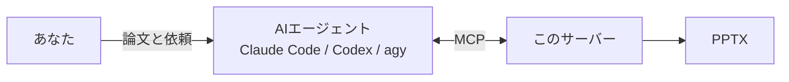

# Research Slide Agent

論文 PDF から、研究室のテンプレートどおりの **編集できる PowerPoint** を作る MCP サーバーです。



- **考えるのは AI エージェント**（論文を読み、構成と文章を作る）。
- **このサーバーは考えません**。資料の保存、PPTX の生成、検査だけをします。

## 使い始める

Docker だけで動きます。

```bash
git clone https://github.com/cercil0605/ResearchSlideAgent.git
cd ResearchSlideAgent
make setup        # claude / codex / agy を選ぶ → ビルド → 登録
```

エージェントを再起動して、こう頼みます。

> research-slides を使って、`~/Downloads/論文.pdf` から10分の研究室発表スライドを作って。

完成した PPTX は `~/ResearchSlides/outputs` に入ります。

| こんなとき | コマンド |
|---|---|
| コードを更新した | `make update` |
| 動かない | `make doctor` |
| 別のエージェントに登録 | `make register AGENT=codex` |

## 仕組みを知る

上から順に読むと、全体が分かります。

| 知りたいこと | ページ |
|---|---|
| どう呼ばれて、どう処理されるか | [01 処理の流れ](docs/01-flow.md) |
| AI は何を呼び、何を受け取るか | [02 AI との約束](docs/02-llm-contract.md) |
| 各入口をどのコードが実装しているか | [03 実装の地図](docs/03-implementation.md) |
| リモートの認証はなぜ・いつ必要か | [04 認証](docs/04-auth.md) |
| テンプレートどおりの見た目をどう作るか | [05 デザイン](docs/05-design.md) |
| 内容をどう作り、どう確かめるか | [06 内容](docs/06-content.md) |
| 何が保存され、いつ消えるか | [07 データと状態](docs/07-state.md) |
| 導入・設定・リモート構築 | [08 運用](docs/08-operate.md) |
| エラーが出た | [09 トラブル対応](docs/09-troubleshoot.md) |
| どこまで確かめたか | [検証状況](docs/verified.md) |
