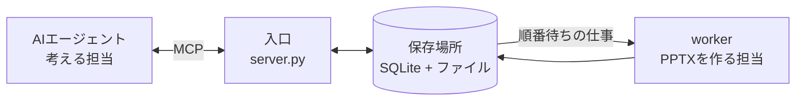
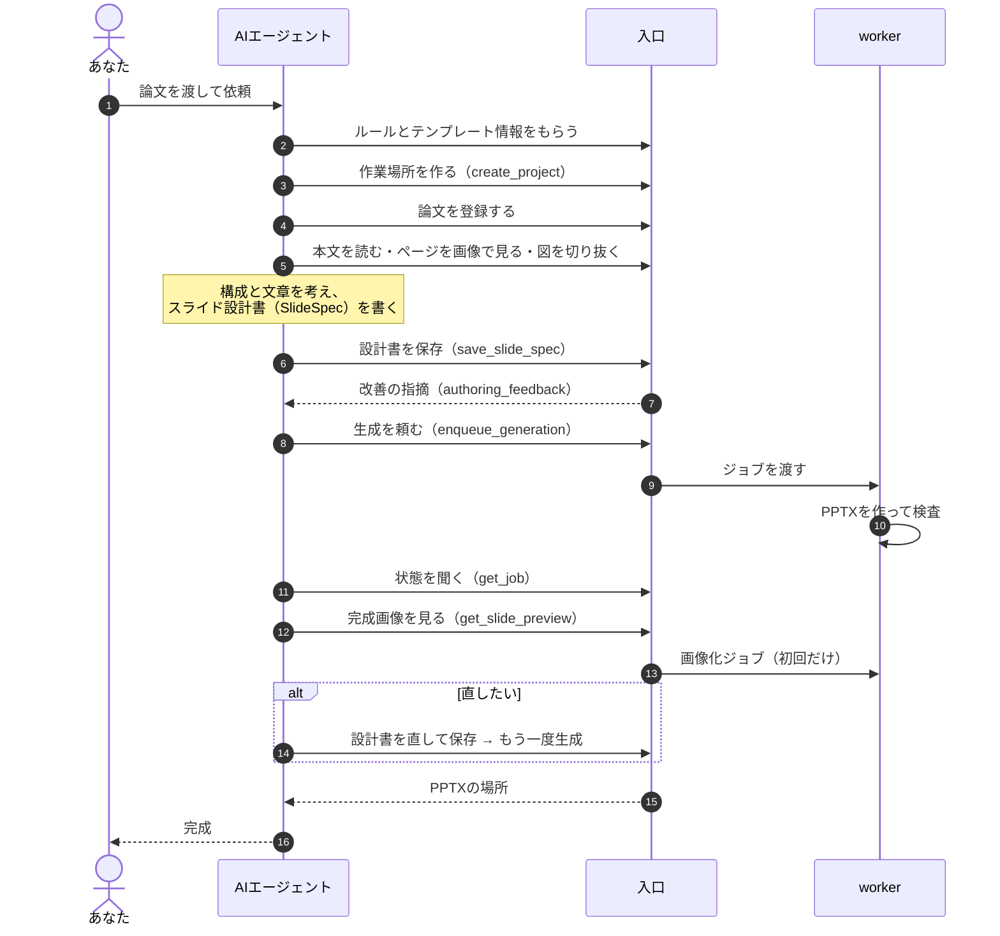
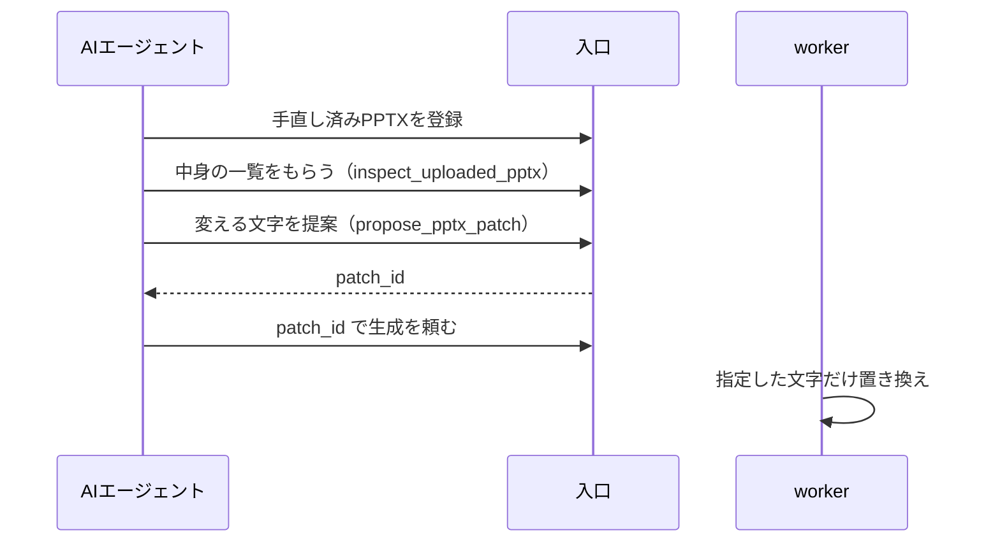

# 01 処理の流れ

AI エージェントがどう呼び、サーバーの中で何が起きるかです。

## 登場するもの

- **入口**は、すぐ終わる仕事（保存、読み出し、ページの画像化）をその場で返します。
- **時間がかかる仕事**（PPTX 生成、完成画像の作成）は「ジョブ」として順番待ちに入れ、**worker** が後で処理します。

## 新しく作るとき

ポイントは2つです。

- 設計書を保存すると、サーバーは**内容ではなく形**の指摘（見出しが残っている、図がない、など）を返します。
- 完成画像は、**AI が自分の目で確かめる**ためのものです。サーバーは見た目の良し悪しを判断しません。

## 人が手で直した PPTX を少し変えるとき

- 変えられるのは**単純な文字の枠だけ**です。書式が混ざった文字や表は変えません。
- 置き換えない部分は、元ファイルと**1バイトも変わりません**。

## なぜこうしたか

- 生成と画像化は時間とメモリを使う（LibreOffice を動かす）ので、入口と分けて順番に処理します。
- サーバーが内容を考えないのは、追加の AI 料金をかけず、どの AI エージェントでも同じ動きにするためです。
