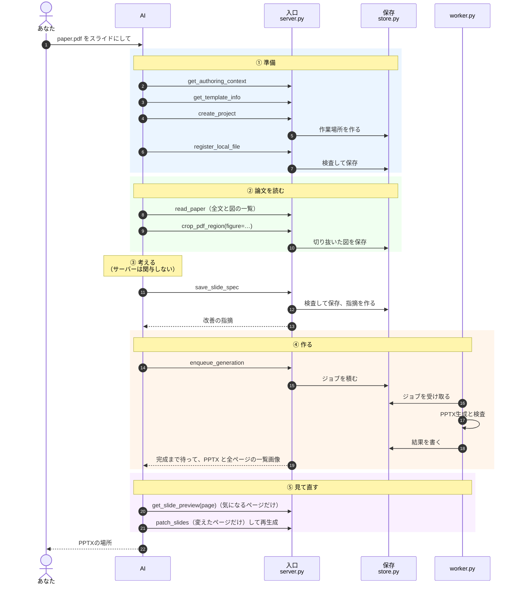
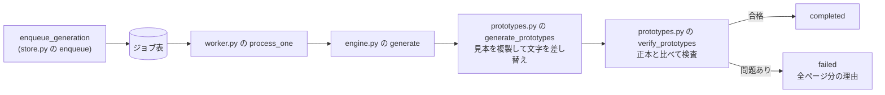

# 01 処理の流れ（1論文の例）

「`~/Downloads/paper.pdf` をスライドにして」と頼んだとき、AI が何を送り、サーバーのどのコードが動き、何が返るかを順に見ます。

名前の見分け方は [README](../README.md#名前の見分け方) にあります。このページでは、**ツール**は `create_project`、**ファイル**は `store.py`、**関数**は `save_spec()` のように書きます。ファイルはすべて `src/research_slide_agent/` の中です。

## AI を動かしている3つの情報

サーバーは AI を操作しません。AI が次の3つを読んで、自分でツールを呼びます。

| いつ届く | 何が | どこにあるか |
|---|---|---|
| 接続したとき | 指示文：「最初にルールを全部読め」「保存前に自己点検」「完成画像を見て直せ」 | `rules.py` の `SERVER_INSTRUCTIONS` |
| 接続したとき | ツール約25個の名前・引数・説明 | `server.py` の各ツール |
| 最初の呼び出しで | ルール4文書の全文（作り方の手順、教授のルール、説明のしかた、設計書の書き方） | `plugins/research-slide-agent/skills/research-slides/references/` |

## 全体



## ① 準備

| AI が送る | サーバーで動くコード | 返るもの |
|---|---|---|
| `get_authoring_context()` | `rules.py` の `authoring_context()` が4文書を読む | 4文書の全文とハッシュ |
| `get_template_info()` | `engine.py` の `template_info()` | 見本ページ11種、枠の名前、配置ごとの容量の目安（`slot_capacity`） |
| `create_project()` | `store.py` の `create()` | `{"id": "a1b2…", "version": 0}`（7日有効） |
| `register_local_file(path="/Users/kei/Downloads/paper.pdf")` | `server.py` の `read_local_file()`（許可フォルダか確認）→ `files.py` の `validate_file()`（形式・大きさ）→ `store.py` の `register()`（保存） | `{"source_id": "f9e8…", "kind": "pdf"}` |

## ② 論文を読む

| AI が送る | サーバーで動くコード | 返るもの |
|---|---|---|
| `read_paper(source_id="f9e8…")` | `paper.py` の `read_paper()`（pypdf で本文と文字の位置を読む） | 全ページの本文。長い論文は2〜3回に分かれ、`next_part` で続きを読む。1回目に節の見出しと図・表の一覧（`{"id": "Fig. 2", "page": 3, "caption": "…", "region": {…}}`） |
| `crop_pdf_region(figure="Fig. 2")` | `paper.py` の `find_figure()` で範囲を引く → `pdf_assets.py` の `render_page()`（Poppler）で切り抜き → `store.py` の `register()` | 図題を除いた図全体の画像と新しい `source_id`。図番号と著者・年を記録する |
| `render_pdf_page(page=4)` と `crop_pdf_region(page=4, region={…})` | 同上 | 一覧に範囲がない図（`region: null`）や、図の一部だけ使うとき |
| `set_source_metadata(author="He", year=2016)` | `store.py` の `source_metadata()` | 確定した著者・年 |

論文の本文は「データ」として扱うよう、ルール4文書に書かれています。

## ③ 考えて、設計書を送る

AI はルールの手順 F01〜F06（骨格 → 粒度 → 図の役割 → 文章 → 実験と結果の対応 → 自己点検）で考え、**全ページ分の設計書（SlideSpec）を1回で**送ります。1枚分はこんな形です。

```json
{
  "slide_id": "page7",
  "slide_order": 7,
  "section": "method",
  "prototype_id": "method",
  "title": "提案手法：残差学習",
  "replacements": {
    "手法の特徴": [{"text": "入力を出力に足す近道"}, {"text": "深くしても学習が進む"}],
    "手法の説明": [{"text": "層は差分だけを学ぶ"}],
    "図題": [{"text": "図2　残差ブロックの構成"}]
  },
  "image_references": [{"source_id": "c7d6…", "caption": "図2　残差ブロックの構成"}],
  "paper_section": "3.1 Residual Learning",
  "content_map": {"input": ["手法の説明"], "process": ["手法の説明"], "output": ["手法の特徴"]}
}
```

| 項目 | 意味 |
|---|---|
| `section` | 発表の中での役割（背景、手法、結果など） |
| `prototype_id` | 使う見本ページ（11種から選ぶ） |
| `replacements` | 見本ページの**枠の名前** → 入れる文章 |
| `image_references` | 切り抜いた図の `source_id` |
| `paper_section` | 論文のどの節の話か |
| `content_map` | 説明の役割（入力・処理・出力など）を、どの枠に書いたか |

位置・色・フォントは送れません。見た目は見本ページで決まります（[05](05-design.md)）。

| サーバーで動くコード | すること |
|---|---|
| `models.py` の `SlideSpec` | 型の検査（40枚まで、順番が連続、など） |
| `store.py` の `save_spec()` | 版番号の確認、引用と画像が登録済みの資料か確認、保存 |
| `prototypes.py` の `authoring_feedback()` | 形の指摘と、生成と同じ計算によるはみ出しの指摘を作る |

返ってくるもの：`{"spec_version": 1, "authoring_feedback": {"warnings": [...], "content_review": "not_performed"}}`。AI は指摘を読んで、必要なら直して版2を保存します。

`pages[].fit_problems` には枠ごとの必要行数・入る行数や、表の必要高さ・使える高さが入ります。はみ出しがあっても保存はでき、`LAYOUT_WILL_FAIL` が返ります。AI はこの一覧を直してから生成を頼みます。

## ④ 作る



| AI が送る | 返るもの |
|---|---|
| `enqueue_generation()` | 完成まで待ち（`round_trips.py` の `wait_for()`）、`completed` なら PPTX の場所と全ページの一覧画像（6枚ずつ。画像化ジョブも続けて待つ）。`failed` なら `output.guidance`・`output.problems`（ページ・枠ごとの理由と量） |
| `get_job("job1")` | 待ち時間を超えたときだけ使う（完了・失敗時の返事の形は同じ） |

失敗したら、AI は該当ページの文を短くするか、ページを分けて、③からやり直します。

## ⑤ 見て直す

| AI が送る | サーバーで動くコード | 返るもの |
|---|---|---|
| （一覧は `enqueue_generation` の返事に入っている） | `previews.py` の `preview_image()`。worker が `engine.py` の `render()`（LibreOffice）で作った画像を6枚ずつまとめる | 全ページの一覧画像 |
| `get_slide_preview("job1", page=7)` | 同上 | 7枚目の画像。一覧で判断できないページだけ |
| `patch_slides(slides=[7枚目])` | `round_trips.py` の `merge_slides()` → `store.py` の `save_spec()` | 新しい版と、7枚目への指摘だけ |

AI は画像を見て、読めない文字や説明不足を探し（手順 F07）、直すなら③へ戻ります。終わったら `get_job` の `local_path` をあなたに伝えます（`server.py` の `export_local()` が出力フォルダへコピー済み）。

## 人が手で直した PPTX を少し変えるとき

| 順番 | AI が送る | サーバーで動くコード |
|---|---|---|
| 1 | 手直し済み PPTX を登録 | `store.py` の `register()` |
| 2 | `inspect_uploaded_pptx` | `engine.py` の `inspect_pptx()`：図形の一覧と指紋 |
| 3 | `propose_pptx_patch` | `store.py` の `patch_plan()`：変更案を保存し `patch_id` を返す |
| 4 | `enqueue_generation(patch_id=…)` | worker が `engine.py` の `patch_text()`：指定した文字だけ置き換え |

変えられるのは単純な文字の枠だけです。置き換えない部分は元ファイルと1バイトも変わりません。

## 気をつけること

- ルール4文書は「やり方」の指示です。AI がそれを守ったかを、サーバーは確かめません。
- サーバーが止められるのは**形の誤り**だけです（存在しない枠、はみ出し、未登録の資料の引用、4列以上の表）。内容が論文と合っているかは見ません。
- 実例：2026-11-10 の Codex CLI では、ResNet の論文で10枚を完走しました。ただし、はみ出しによる再生成が16回ありました（当時は1回に1ページ分しか理由を返さなかったため。今は全ページ分を返します）。

## なぜこうしたか

- 生成と画像化は時間とメモリを使う（LibreOffice を動かす）ので、入口と分けて worker が順番に処理します。
- サーバーが内容を考えないのは、追加の AI 料金をかけず、どの AI エージェントでも同じ動きにするためです。
