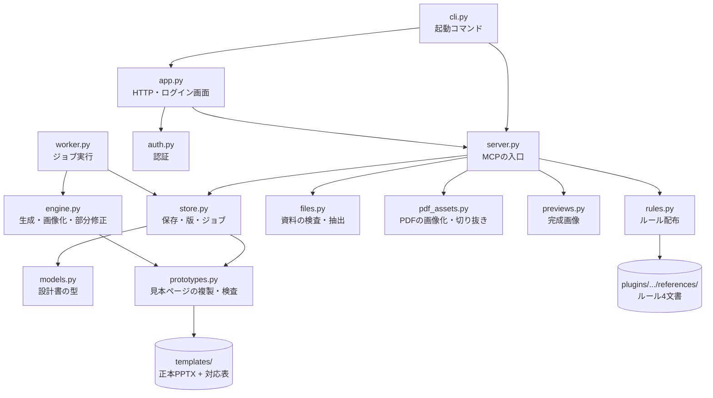
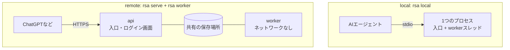

# 03 実装の地図

各入口を、どのファイルが実装しているかです。コードは `src/research_slide_agent/` にあります。

## ファイルのつながり

## 入口と実装

| 入口 | 主な実装 |
|---|---|
| `get_authoring_context` | `rules.py` `authoring_context()` |
| `get_template_info` | `engine.py` `template_info()` |
| `create_project` / `get_project` | `store.py` `create()` / `project()` |
| `register_local_file` | `server.py` `read_local_file()` → `store.py` `register()` → `files.py` `validate_file()` |
| `register_chatgpt_file` | `server.py` `download_attachment()` → `store.py` `register()` |
| `create_upload` | `auth.py` `sign()`、受け口は `app.py` `upload()` |
| `set_source_metadata` | `store.py` `source_metadata()` |
| `read_source` | `files.py` `extract()` |
| `render_pdf_page` / `crop_pdf_region` | `pdf_assets.py` `render_page()` |
| `save_slide_spec` | `models.py` の型チェック → `store.py` `save_spec()` → `prototypes.py` `authoring_feedback()` |
| `patch_slide` | `server.py` 内で1枚差し替え → `store.py` `save_spec()` |
| `enqueue_generation` / `retry_job` | `store.py` `enqueue()` / `retry()` |
| ジョブの実行 | `worker.py` `process_one()` → `engine.py` `generate()` → `prototypes.py` `generate_prototypes()` |
| `get_job` / `get_preview` | `server.py` `links()` |
| `get_slide_preview` | `previews.py` → worker が `engine.py` `render()` |
| `get_generation_report` | 生成時に書いた `*.manifest.json` を返す |
| `inspect_uploaded_pptx` / `propose_pptx_patch` | `engine.py` `inspect_pptx()` / `store.py` `patch_plan()`、実行は `engine.py` `patch_text()` |

## local と remote の違い

| | local | remote |
|---|---|---|
| つなぎ方 | 標準入出力（AI がプロセスを起動） | HTTPS の `/mcp` |
| 認証 | なし | あり（[04](04-auth.md)） |
| 資料の受け取り | 許可フォルダのパス | ChatGPT の添付、またはブラウザから |
| 成果物の渡し方 | 出力フォルダにコピーしてパスを返す | 10分有効のダウンロード URL |
| 無い入口 | `register_chatgpt_file`、`create_upload`、`show_viewer` | `register_local_file` |
| 共通 | 保存、生成、検査、テンプレート、ルール | 同左 |

local は `cli.py` の `run_local()` が、入口と worker を1つのプロセスで起動します。

## なぜこうしたか

- local と remote で中身（保存・生成・検査）を共通にし、違いを「入口と出口」だけにしています。片方だけ直して食い違うのを防ぐためです。
