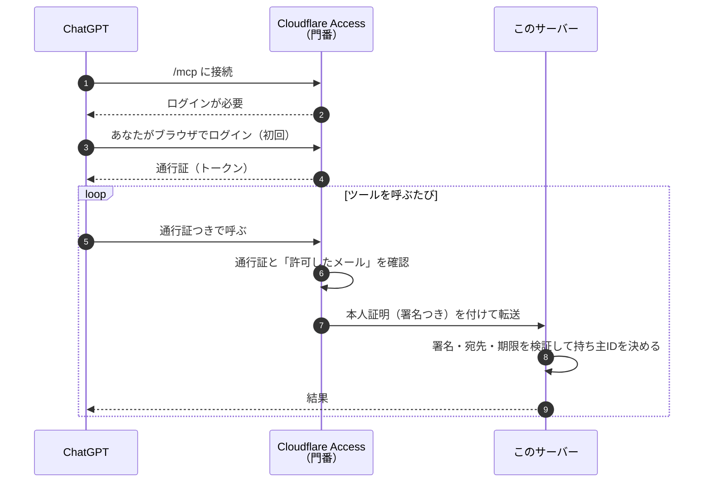
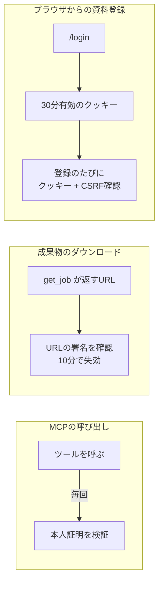

# 04 認証

## まず結論

| | local | remote |
|---|---|---|
| 認証 | **なし** | **リクエストのたびに確認** |
| 理由 | ネットワークで待ち受けない。話せるのは、サーバーを起動した AI エージェントだけ | インターネットに公開するので、誰でもアクセスを試せる |

remote で守っているものは3つです。

1. **未発表の論文や原稿**を、他人に読まれないこと。
2. **他人の作業場所**を、見たり触ったりできないこと（作業場所は持ち主の ID で区切られています）。
3. **サーバーの計算資源**を、他人に使われないこと。

## いつ認証されるか（Cloudflare 方式）

おすすめの構成は、Cloudflare Access に門番をしてもらう方式です（`RSA_AUTH_MODE=cloudflare`）。

- サーバーは、Cloudflare が付ける署名つきの本人証明（`Cf-Access-Jwt-Assertion`）を**毎回**検証します（`auth.py` の `cloudflare_owner()`）。
- 持ち主 ID は `cloudflare:<Cloudflareの利用者ID>` になります。
- 誰を許可するかは、Cloudflare 側のポリシーで決めます。サーバーは許可リストを持ちません。
- 検証しないで通すのは、`/health` と、認証方法を案内する `/.well-known/oauth-protected-resource` だけです。

## 認証が出てくる場面

| 場面 | いつ | 何を確認 | 有効期間 |
|---|---|---|---|
| ツール呼び出し | 毎回 | Cloudflare の本人証明 | 毎回検証 |
| PPTX・画像のダウンロード | URL を開いたとき | URL の署名（`auth.py` の `sign()`） | 10分 |
| 手動アップロード用 URL（`create_upload`） | アップロードのとき | URL の署名 ＋ 本人が持ち主か | 10分 |
| ブラウザの登録画面 | 操作のたび | クッキー ＋ CSRF の合言葉 | 30分 |
| ChatGPT の添付の取り込み | 取り込みのとき | 取り込み先が許可したホストか（既定 `*.oaiusercontent.com`）、HTTPS か、公開 IP か | — |

**注意**：Cloudflare 方式では、ダウンロード URL は**持ち主専用ではありません**。Cloudflare にログインできる人なら、URL を持っていれば開けます（`app.py` の `artifact()`）。URL は10分で失効します。

## もう1つの方式（OAuth）

既存の認証サーバーを使う方式です（`RSA_AUTH_MODE=oauth`、既定値）。違いは次のとおりです。

- サーバー自身がアクセストークンを検証します（署名、発行元、宛先、`slides:write` 権限、許可リスト `RSA_ALLOWED_SUBS`）。
- ID トークンは受け付けません。Google の ID トークンを直接使う設定は、起動時に拒否します。
- ダウンロード URL を開くとき、持ち主がまだ許可リストにいるかも確認します。

## 開発用

`RSA_DEV=1` のときは、同じ PC（ループバック）からの接続だけを `dev-user` として通します。公開 URL と一緒には起動できません（`config.py` の `validate()`）。

## なぜこうしたか

- 自前でログイン画面やパスワードを持つと、守る対象が増えます。本人確認は Cloudflare に任せ、サーバーは「本物の証明か」だけを確かめます。
- ダウンロードを署名つき URL にしたのは、ChatGPT の画面からそのまま開けるようにするためです。
