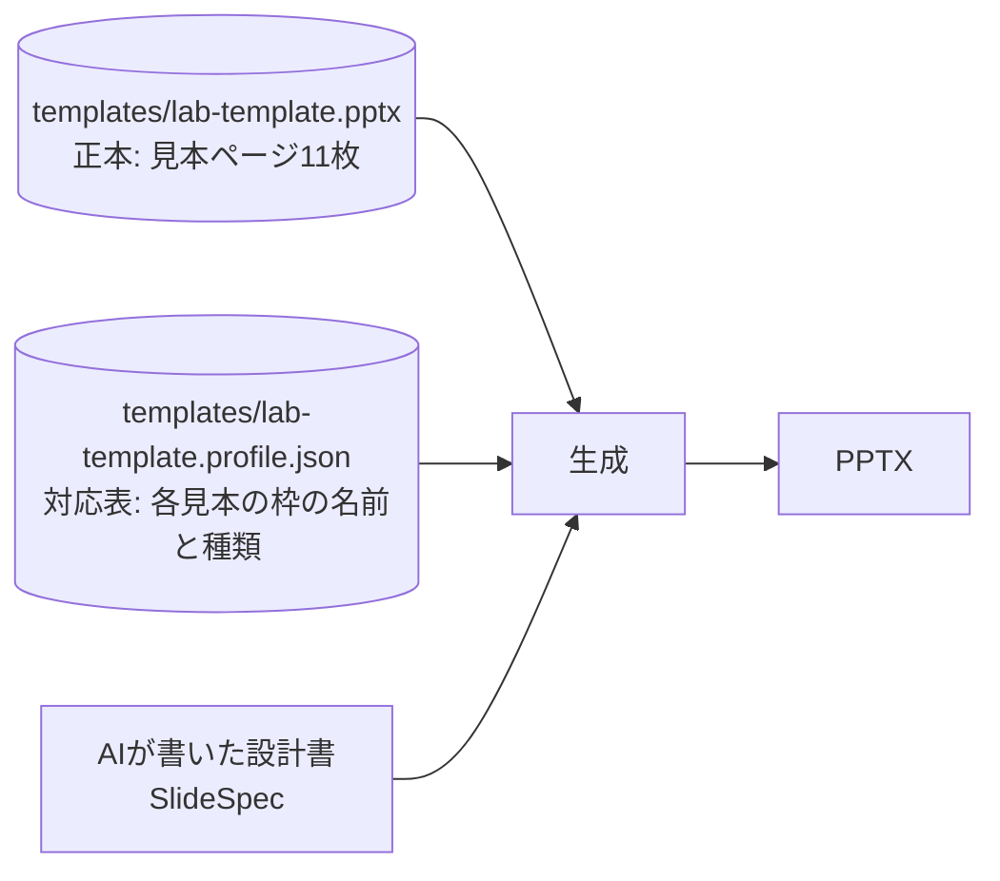
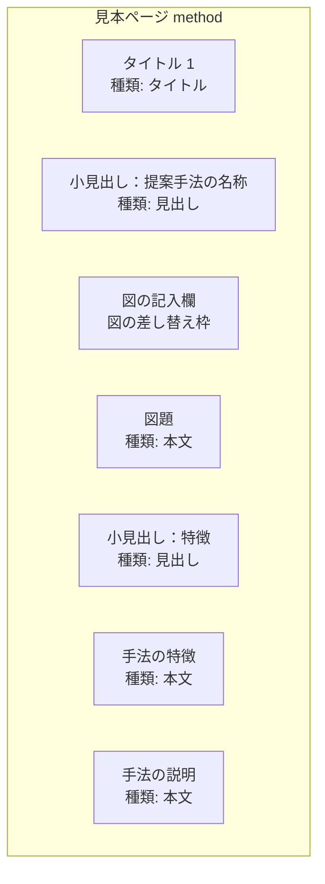
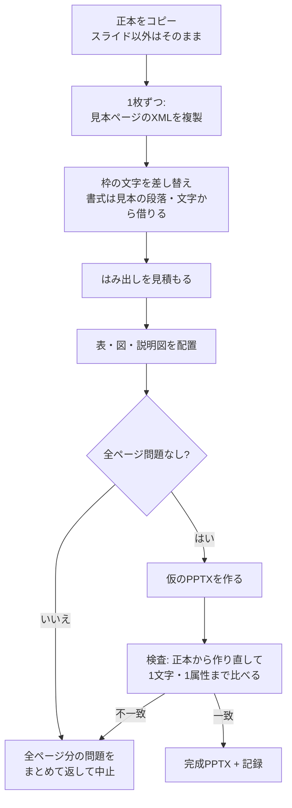

# 05 デザイン

テンプレートどおりの見た目を、どう作っているかです。

## 一言でいうと

**白紙から描かず、テンプレートの見本ページをコピーして、文字だけ差し替えます。**
AI は位置・色・フォントを指定できません。だから見た目が崩れません。

## 材料

見本ページは11種類です。

| 見本 ID | 用途 | 見本 ID | 用途 |
|---|---|---|---|
| `cover` | 表紙 | `experiment` | 実験方法 |
| `overview` | 概要（図あり） | `results_figure` | 結果（大きな図） |
| `background` | 背景 | `results_table` | 結果（表） |
| `related` | 関連研究 | `discussion` | 考察 |
| `objective` | 目的 | `summary` | まとめ |
| `method` | 手法（図あり） | | |

## 1枚の見本ページの中身

`method` の例です。枠ごとに名前と種類が決まっています。

AI は設計書でこう指定します。

- `prototype_id`：どの見本を使うか
- `title`：タイトル
- `replacements`：枠の名前ごとに入れる文章
- 図・表：`diagram_spec`（箱と矢印の説明図）、`table_spec`（表）、`image_references`（論文から切り抜いた図）
- `composition`：`method` だけ、本文と図の配分を3通りから選べる（文章＋小図、表＋図、図2枚）

## 生成の手順

（`prototypes.py` の `generate_prototypes()` と `verify_prototypes()`）

## 何を守っているか

| 守るもの | 方法 |
|---|---|
| マスター・ロゴ・テーマ | スライド以外の部品を**1バイトも変えない**。検査で確認 |
| 文字の書式 | 書式は AI から受け取らず、**見本ページの段落・文字の書式をコピー**する |
| 文字のはみ出し | 枠の大きさから**控えめに**見積もり、入らなければ失敗（`TEXT_OVERFLOW`） |
| 表 | 見本の表の行をコピー。**3列まで**、罫線・中央揃えを保つ |
| 論文の図 | 元の画像データをそのまま埋め込む |
| 中途半端なファイル | 検査に通ったものだけ保存。失敗したら何も残さない |
| 出所 | 正本のハッシュ、設計書のハッシュ、コードの版を PPTX 内に記録 |

## 限界

- はみ出しは**見積もり**です。PowerPoint での実際の表示は確かめていません。
- 見出しの枠に何も指定しないと、見本の文字（例：「特徴」）が**そのまま残ります**。本文の枠は空になります。
- 表は設計書の型では6列まで書けますが、生成は3列までです。4列以上は生成で失敗します。

## テンプレートを変えるとき

`scripts/prepare_skeleton_template.py --source 新しい.pptx` で正本と対応表を作り直します。正本が変わると、保存済みの設計書は生成できなくなります（`TEMPLATE_CHANGED_RESAVE_REQUIRED`）。もう一度保存し直してください。

## なぜこうしたか

- AI に座標や色を任せると、毎回見た目が変わり、研究室の書式から外れます。「見本から選んで文字を入れる」に限定すると、崩れようがありません。
