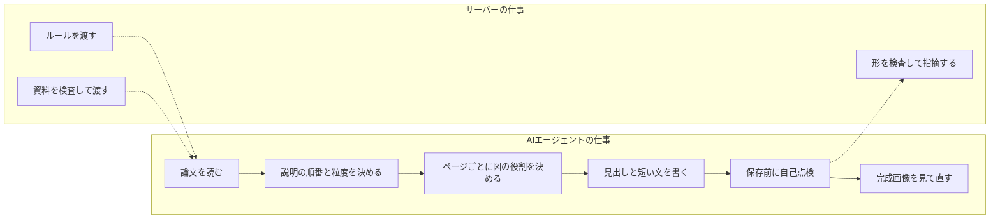
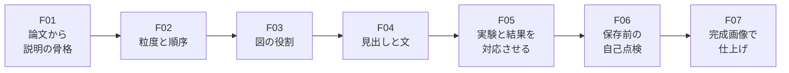
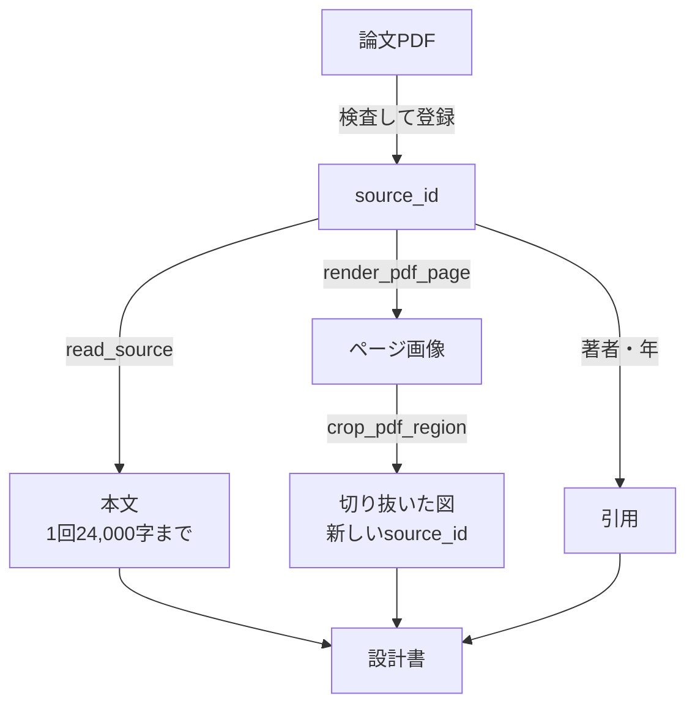
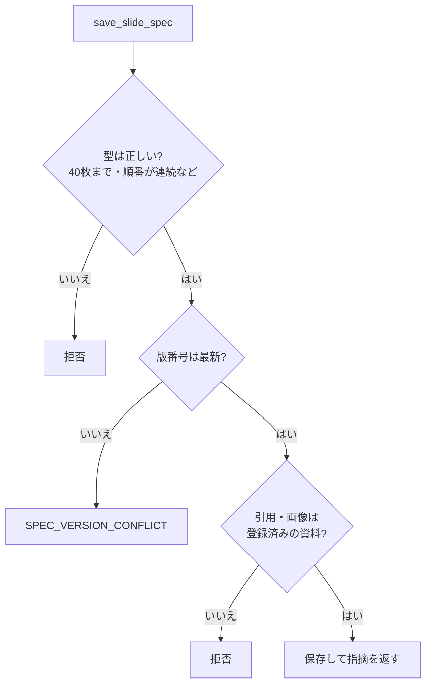

# 06 内容

スライドの「中身」をどう作り、どう確かめているかです。

## 役割分担

**内容の良し悪しを判断するのは AI だけです。** サーバーの指摘は「形」の指摘で、`content_review: not_performed`（内容は見ていない）と明記して返します。

## AI に渡すルール

`get_authoring_context` が、次の4文書を全文で渡します。原本は `plugins/research-slide-agent/skills/research-slides/references/` です。

| 文書 | 中身 |
|---|---|
| `authoring-workflow.md` | 作り方の手順 F01〜F07 |
| `professor-guidelines.md` | 教授の明示ルール G01〜（構成、図、引用、表など） |
| `presentation-guidelines.md` | 過去の発表資料から読み取った説明のしかた |
| `canonical-skeleton.md` | 設計書（SlideSpec）の書き方 |

作り方の手順（F01〜F07）：

基本の構成は「表紙 → 概要 → 背景 → 関連研究 → 目的 → 手法 → 実験 → 結果 → 考察 → まとめ」です。

## 論文から設計書まで

- 切り抜いた図は、元の PDF の著者・年を**自動で引き継ぎます**。図ごとに入力は不要です。
- 設計書の引用は、登録した資料の著者・年と**一致しないと保存できません**（`SOURCE_METADATA_MISMATCH`）。
- 本文が長いときは途中で切られ、`truncated: true` が返ります。

## 受け付ける資料

| 項目 | 上限・条件 |
|---|---|
| 種類 | PDF、PPTX、PNG、JPEG、CSV（UTF-8）、XLSX |
| 1ファイル | 20 MiB |
| 1つの作業場所 | 登録資料10件、切り抜き図80件、合計100 MiB |
| PDF | 暗号化なし、500ページまで |
| Office | マクロ、外部リンク、埋め込みバイナリは拒否 |

（`files.py`、`store.py` の `register()`）

## 設計書を保存したときの検査

返す指摘の例：

| コード | 意味 |
|---|---|
| `MISSING_EXPLANATORY_VISUAL` | 表紙以外に図がない |
| `VISUAL_LAYOUT_UNSUPPORTED` | 選んだ見本に図や表の枠がない |
| `SHARED_CONTENT_TARGET_REVIEW` | 複数の役割（入力・処理など）が同じ本文枠を指している |
| `METHOD_FIGURE_LAYOUT_REVIEW` | 手法のページが図の説明だけになっていないか |
| `ADJACENT_TABLE_MERGE_REVIEW` | 隣のページの表とまとめられそう |

ほかに、見出し枠に見本の文字が残っているページ（`inherited_headings`）と、研究発表で各ページに必要な役割のうち足りないもの（`missing_page_roles`）も返します。

## なぜこうしたか

- ルールをサーバーから配ると、どの AI エージェントにも同じ版のルールが届きます。文書ごとのハッシュも返すので、どの版を使ったか追えます。
- サーバーは内容を判断しないので、指摘は「確認のきっかけ」です。合否ではありません。
