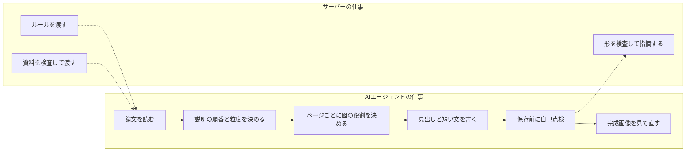
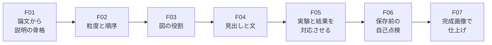
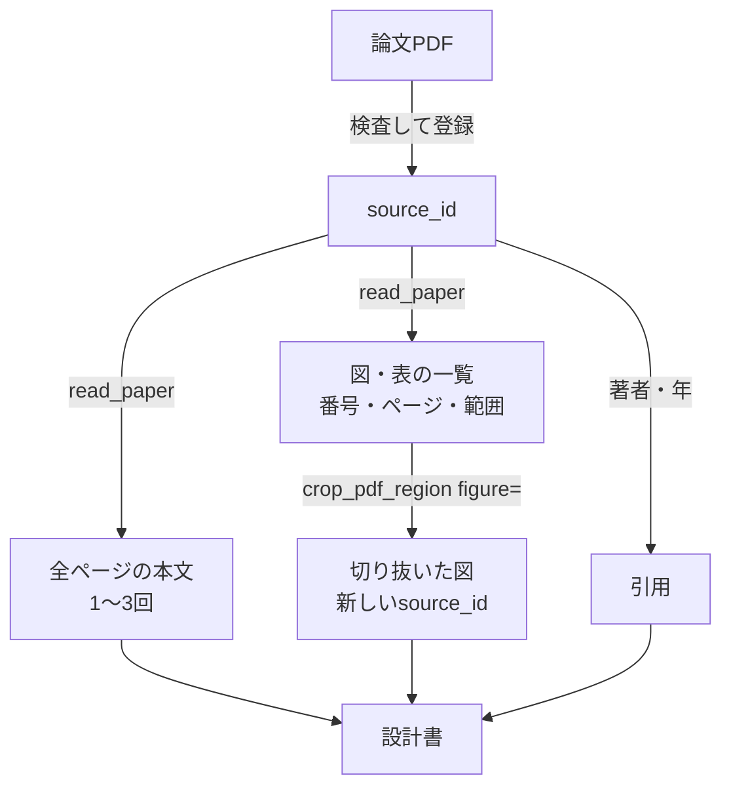
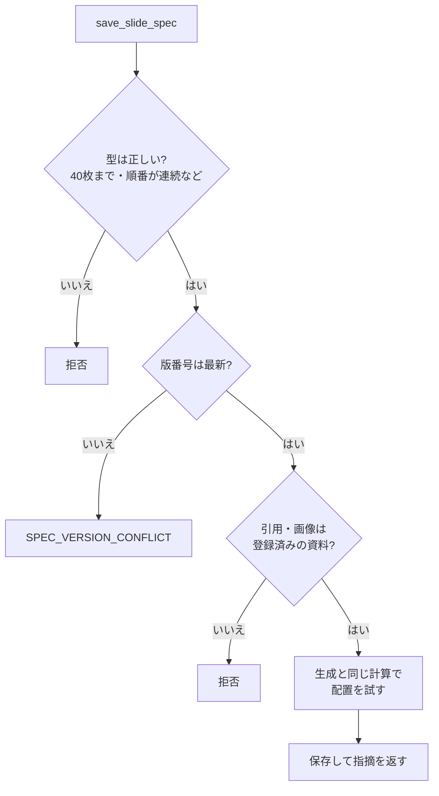

# 06 内容

スライドの「中身」をどう作り、どう確かめているかです。

## 役割分担

**内容の良し悪しを判断するのは AI だけです。** サーバーの指摘は「形」の指摘で、`content_review: not_performed`（内容は見ていない）と明記して返します。

## AI に渡すルール

`get_authoring_context` が、次の4文書を全文で渡します。原本は `plugins/research-slide-agent/skills/research-slides/references/` です。

| 文書 | 中身 |
|---|---|
| `authoring-workflow.md` | 作り方の手順 F01〜F07 |
| `professor-guidelines.md` | 教授の明示ルール G01〜（構成、図、引用、表など） |
| `presentation-guidelines.md` | 過去の発表資料から読み取った説明のしかた |
| `canonical-skeleton.md` | 設計書（SlideSpec）の書き方 |

作り方の手順（F01〜F07）：

基本の構成は「表紙 → 概要 → 背景 → 関連研究 → 目的 → 手法 → 実験 → 結果 → 考察 → まとめ」です。

## 論文から設計書まで

- 切り抜いた図は、元の PDF の著者・年を**自動で引き継ぎます**。図ごとに入力は不要です。
- 設計書の引用は、登録した資料の著者・年と**一致しないと保存できません**（`SOURCE_METADATA_MISMATCH`）。
- 本文は切り詰めずに全部返します。1回の返事は約2万トークンまでで、超える論文は part に分かれます（`paper.py` の `PART_TOKENS`）。Claude Code の MCP 出力上限（約2.5万トークン）に収めるためです。
- 図の範囲は、図題の位置と周りの本文行から推定します（`paper.py` の `_inventory_page()`）。2段組みは論文全体で判定し、ページの上下に繰り返し出る柱は区切りとして扱います。表は表として作り直すため、範囲は返しません。
- 文字で書かれたアルゴリズムなど、範囲が決められない図は `region: null` です。そのときは `render_pdf_page` で見て範囲を指定します。

## 受け付ける資料

| 項目 | 上限・条件 |
|---|---|
| 種類 | PDF、PPTX、PNG、JPEG、CSV（UTF-8）、XLSX |
| 1ファイル | 20 MiB |
| 1つの作業場所 | 登録資料10件、切り抜き図80件、合計100 MiB |
| PDF | 暗号化なし、500ページまで |
| Office | マクロ、外部リンク、埋め込みバイナリは拒否 |

（`files.py`、`store.py` の `register()`）

## 設計書を保存したときの検査

返す指摘の例：

| コード | 意味 |
|---|---|
| `EMPTY_FIGURE_FRAME` | 図枠のある見本（method・overview・results_figure）を図なしで使った。空の枠が残るので、文字だけの見本にするか、情報を足す図を入れる |
| `TRIVIAL_DIAGRAM` | 分岐もラベルもない3つ以下の箱の図。本文の繰り返しなので、消すか原図にする |
| `VISUAL_LAYOUT_UNSUPPORTED` | 選んだ見本に図や表の枠がない |
| `SHARED_CONTENT_TARGET_REVIEW` | 複数の役割（入力・処理など）が同じ本文枠を指している |
| `METHOD_FIGURE_LAYOUT_REVIEW` | 手法のページが図の説明だけになっていないか |
| `ADJACENT_TABLE_MERGE_REVIEW` | 隣のページの表とまとめられそう |
| `LAYOUT_WILL_FAIL` | このまま生成すると配置の検査で失敗する。`pages[].fit_problems` の各項目を直す |

図のないページは、それだけでは指摘しません（教授ルール G11 を2026-11に緩めた。`prototypes.py` の `authoring_feedback()`）。

PDF から切り抜いた図（`crop_pdf_region`）の図題には、論文の図・表番号が必要です。図題になく、`crop_pdf_region(figure=…)` で切り抜いた図ならその番号を、そうでなければその図の引用 locator（例 `p.5 Fig.7(a)`）の番号を使い、保存時に図題の先頭へ付けて `authoring_feedback.figure_numbers_added` で知らせます。どちらにもなければ `FIGURE_NUMBER_REQUIRED` で保存できません（`figures.py` の `number_captions()`）。利用者が渡した写真には求めません。

ほかに、見出し枠に見本の文字が残っているページ（`inherited_headings`）と、研究発表で各ページに必要な役割のうち足りないもの（`missing_page_roles`）も返します。

`pages[].fit_problems` は文字枠の必要行数と入る行数、表の行数上限や必要高さ、図の配置の問題を返します。登録済みの原図を使うページも検査します（`store.py` の `save_spec()` → `prototypes.py` の `authoring_feedback()` / `build_slide()`）。はみ出しがあっても保存はできます。必要な事実を残したまま文や配置を見直し、指摘を解消してから生成します。この検査は実際の描画や内容の評価ではありません。

## なぜこうしたか

- ルールをサーバーから配ると、どの AI エージェントにも同じ版のルールが届きます。文書ごとのハッシュも返すので、どの版を使ったか追えます。
- サーバーは内容を判断しないので、指摘は「確認のきっかけ」です。合否ではありません。
