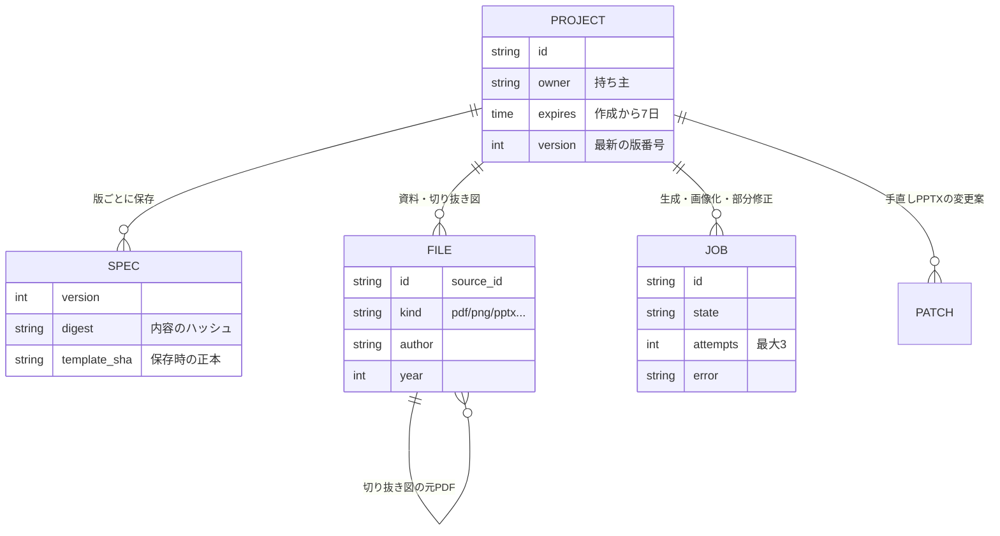
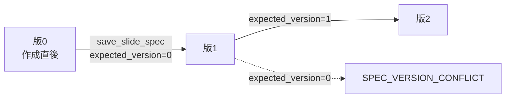
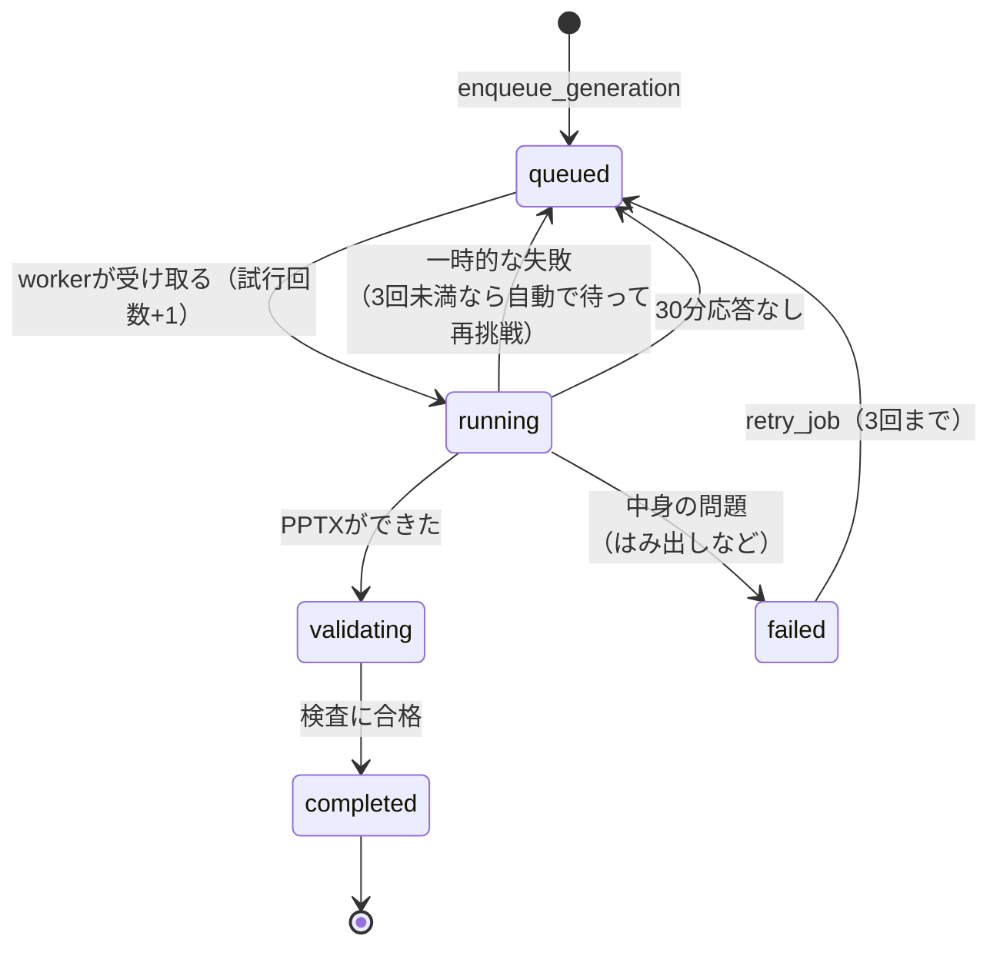
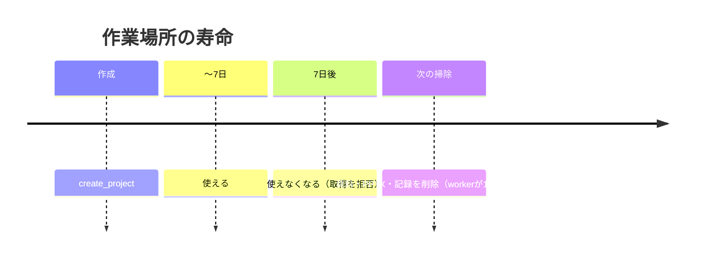

# 07 データと状態

何が保存され、どう変わり、いつ消えるかです（`store.py`）。

## 保存しているもの

- データベースは SQLite 1つ（`<データ置き場>/state.sqlite3`）。ファイルは `<データ置き場>/<作業場所ID>/` の下に置きます。
- データ置き場は、local（Docker）なら `~/ResearchSlides/.rsa-data`、remote なら Docker のボリューム `/data` です。

## 版番号

保存のたびに版が1つ上がります。古い版を前提に保存しようとすると拒否されます（同時に2か所から書き換えて上書きするのを防ぐため）。

## ジョブの一生

| 決まり | 内容 |
|---|---|
| 同じ設計書 | 同じ内容のジョブがあれば、新しく作らずそれを返す |
| 1人1ジョブ | 自分のジョブが動いている間は、次を入れられない（`USER_JOB_LIMIT`） |
| 全体の同時実行 | 1〜2件（`RSA_WORKER_LIMIT`） |
| 一時的な失敗 | ファイル読み書きの失敗などは、3回目まで自動で再挑戦（待ち時間は2秒、4秒と増える） |
| 中身の失敗 | はみ出しなどは自動では再挑戦しない。設計書を直して保存し直す |
| 応答なし | 30分たっても終わらないジョブは、やり直しに戻す |

## いつ消えるか

| もの | 期限 |
|---|---|
| 作業場所と中身すべて | 作成から7日（延長なし） |
| ダウンロード URL（remote） | 10分 |
| ブラウザのログイン（remote） | 30分 |
| local の出力フォルダにコピーした PPTX | **消えない**（あなたのファイル） |
| worker のログ（`<データ置き場>/logs/`） | 約7日（1日ごとに切り替え、6日分を保持） |

## なぜこうしたか

- 研究資料を長く持たないため、期限は作成から7日で固定しています。
- データベースを SQLite 1つにしたのは、Raspberry Pi 1台で動かすためです。
