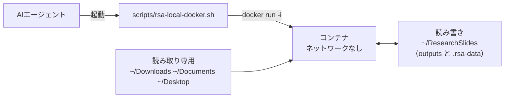
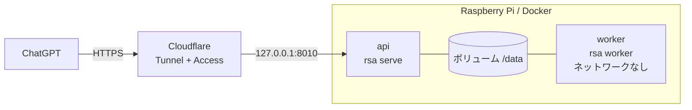
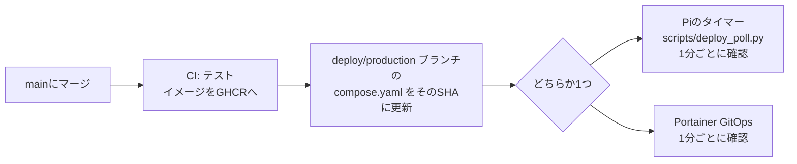

# 08 運用

導入、更新、リモートの構築です。

## local（自分の PC）



- コンテナは常駐しません。AI エージェントが必要なときに起動し、終わると消えます。
- フォルダは**同じ絶対パス**でマウントするので、AI が渡すパスと返ってくるパスは、そのまま PC 上のパスです。

| コマンド | すること |
|---|---|
| `make setup` | エージェントを選ぶ → イメージを作る → 登録 → 状態確認。選んだ CLI がなければ中止 |
| `make update` | `git pull` → 再ビルド。登録し直しは不要。エージェントを再起動 |
| `make register AGENT=claude\|codex\|agy` | 登録だけ |
| `make unregister AGENT=...` | 登録を外す |
| `make doctor` | Docker、イメージ、スクリプトを確認 |
| `make smoke` | サーバーに1回あいさつして応答を確認 |

| 変えたいもの | 環境変数 |
|---|---|
| 読み取り専用で見せるフォルダ | `RSA_INPUT_DIRS=/a:/b` |
| 出力とデータの場所 | `RSA_LOCAL_DIR`（既定 `~/ResearchSlides`） |
| 使うイメージ | `RSA_IMAGE` |

**ほかのクライアント**（Claude Desktop、Cursor など）は、設定ファイルの `mcpServers` に次を足します。

```json
{"mcpServers": {"research-slides": {"command": "/絶対パス/scripts/rsa-local-docker.sh"}}}
```

**Docker を使わない場合**：`uv run rsa local --input-dir ~/ResearchSlides --output-dir ~/ResearchSlides/outputs`。PDF の画像化に Poppler、完成画像に LibreOffice が必要です。

**ChatGPT** の通常のチャットからは、local は使えません（ChatGPT のクラウドから手元のプロセスは呼べないため）。ChatGPT デスクトップの Codex／Work モードは、Codex と同じ登録を使う見込みですが、未確認です。

## remote（公開サーバー）



### 初回の構築

1. イメージを用意する：CI が GHCR に公開したもの（`ghcr.io/cercil0605/researchslideagent:<コミットSHA>`）か、`docker build`。
2. `.env.example` をもとに環境変数を決める（下の表）。
3. Portainer の Stacks に `deploy/portainer-stack.yml` を貼り付けて起動する（または `compose.yaml`）。
4. Cloudflare Tunnel で公開ホスト名を `http://127.0.0.1:8010` へ転送する。
5. Cloudflare Zero Trust で、そのホスト名**全体**を守る Access アプリを作る。
   - 許可ポリシーは自分のメールだけ。
   - アプリの AUD タグを `RSA_CF_AUDIENCE` に入れる。
   - 詳細設定で **Managed OAuth** を有効にし、Dynamic Client Registration をオンにする。ChatGPT の画面に出る redirect URI を許可する。
6. ChatGPT の Plugins で **Add custom MCP server** を選び、`https://<ホスト名>/mcp` を **OAuth** で登録する。

### 環境変数

| 変数 | 内容 |
|---|---|
| `RSA_BASE_URL` | 公開 URL（`https://...`、末尾の `/` なし） |
| `RSA_AUTH_MODE` | `cloudflare`（推奨）または `oauth` |
| `RSA_CF_TEAM_DOMAIN` | `https://<チーム>.cloudflareaccess.com` |
| `RSA_CF_AUDIENCE` | Access アプリの AUD タグ |
| `RSA_SESSION_KEY` | 32文字以上のランダム値。変えない |
| `RSA_ATTACHMENT_HOSTS` | ChatGPT 添付の取得先。既定 `*.oaiusercontent.com` |
| `RSA_WORKER_LIMIT` | 同時に動くジョブ数（1か2） |
| `RSA_IMAGE` | 使うイメージ |
| `RSA_OAUTH_ISSUER` `RSA_JWKS_URL` `RSA_OAUTH_AUDIENCE` `RSA_WEB_CLIENT_ID` `RSA_ALLOWED_SUBS` | `oauth` 方式のときだけ（`.env.oauth.example`） |

設定が足りない・おかしいときは、起動時にエラーで止まります（`config.py` の `validate()`）。

### 更新



- **2つを同時に使わないでください**。同じコンテナを二重に管理して、更新がぶつかります。
- タイマー方式は `deploy/research-slide-agent-update.service` と `.timer` を `/etc/systemd/system/` に置いて有効にします。
- 戻すときは、前のコミット SHA のイメージを指定して起動し直します。

## なぜこうしたか

- local は「Docker があれば動く」を最優先にし、Python や LibreOffice をあなたの PC に入れなくて済むようにしています。
- remote の worker はネットワークを持ちません。論文や PPTX を処理する部分から外へ通信できないようにするためです。
