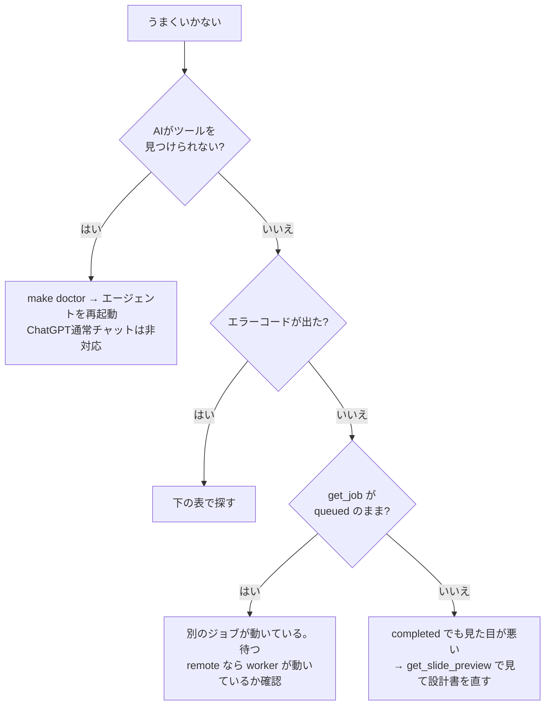

# 09 トラブル対応

## どこで止まったか

## エラーコード

| コード | 意味 | どうする |
|---|---|---|
| **資料** | | |
| `LOCAL_PATH_NOT_ALLOWED` | 読めないフォルダのファイル | 許可フォルダ（`~/Downloads` など）に置くか `RSA_INPUT_DIRS` を変える |
| `LOCAL_PATH_NOT_ABSOLUTE` / `LOCAL_FILE_NOT_FOUND` | パスの指定ミス | 絶対パスで渡す |
| `PROJECT_FILE_LIMIT` / `PROJECT_ASSET_LIMIT` | 資料10件・図80件・合計100 MiB を超えた | 新しい作業場所を作る |
| `ATTACHMENT_ORIGIN_NOT_ALLOWED` | 添付の取得先が許可されていない | `RSA_ATTACHMENT_HOSTS` を確認 |
| `ATTACHMENT_HTTP_*` / `ATTACHMENT_TIMEOUT` | 添付の取得に失敗 | ChatGPT で添付し直す。ログインの問題ではない |
| `PDF_DPI_INVALID` / `PDF_REGION_INVALID` | 画像化・切り抜きの指定ミス | 解像度は72〜300、範囲は0〜1 |
| `FIGURE_ID_INVALID` | `crop_pdf_region(figure=…)` の書き方が違う | `read_paper` の `figures` にある `Fig. 3`・`Table 2` の形で渡す |
| `FIGURE_NOT_FOUND` | その番号の図題が PDF で見つからない | `read_paper` の一覧を見直す。なければ `render_pdf_page` で見て page と region を渡す |
| `FIGURE_REGION_UNKNOWN` | 図の範囲を推定できない（表、文字だけのアルゴリズムなど） | `render_pdf_page` で見て page と region を渡す。表は `table_spec` で作る |
| `PART_INVALID` | `read_paper` の part が範囲外 | 1 から `parts` までを読む |
| **設計書** | | |
| `SPEC_VERSION_CONFLICT` | 版番号が古い | `get_project` で最新の版を見てから保存 |
| `SOURCE_METADATA_MISMATCH` | 引用の著者・年が登録と違う | `set_source_metadata` で論文どおりに設定 |
| `SOURCE_ALREADY_REFERENCED` | 使用中の資料の著者・年は変えられない | 正しい資料を登録し直して設計書を直す |
| `FIGURE_NUMBER_REQUIRED` | 切り抜いた図の図題・切り抜きの記録（`figure=` で切った図）・引用の locator のどれにも図番号がない。または番号を足すと図題が200字を超える | `crop_pdf_region(figure=…)` で切り直すか、図題か locator に `Fig. 3`・`Table 2` などを書く。長い図題は短くする |
| `TEMPLATE_CHANGED_RESAVE_REQUIRED` | 正本が更新された | 設計書を保存し直す |
| **生成** | | |
| `LAYOUT_REQUIRES_USER_CHANGE` | 収まらないなど、配置の問題 | `output.problems` の全ページ・枠の指摘を直して保存し直す。`output.guidance` は短い説明 |
| `TEXT_OVERFLOW` / `TABLE_OVERFLOW` | 文字・表が枠に入らない | 文を短くする、ページを分ける、配置を変える |
| `TABLE_COLUMNS` | 表が4列以上 | 3列以下にする |
| `DIAGRAM_LABEL_OVERLAP` | 矢印のラベル同士が候補位置でも重なる | 条件を箱の中へ移すか、意味の区切りで図を分ける |
| `USER_JOB_LIMIT` | 自分のジョブがまだ動いている | 終わるまで待つ |
| `RETRY_LIMIT_OR_NOT_FAILED` | 3回試した、または失敗していない | 設計書を直して新しく生成 |
| `IO_FAILURE` | 一時的な読み書きの失敗 | 自動で再挑戦される。続くなら `retry_job` |
| `PROJECT_NOT_FOUND_OR_EXPIRED` | 7日たった、または ID 違い | 新しく作る |
| **完成画像** | | |
| `PREVIEW_BUSY` | 別の処理中 | 少し待って再度呼ぶ |
| `PREVIEW_RENDER_FAILED` | 画像化に失敗（PPTX は無事） | `retry_job` に `preview_job_id` を渡す |
| **手直し PPTX** | | |
| `EDIT_CONFLICT` | 登録後に図形が変わった | `inspect_uploaded_pptx` からやり直す |
| `UNSUPPORTED_SHAPE` / `UNSUPPORTED_RICH_TEXT` | 変えられない種類の文字 | PowerPoint で手で直す |
| **remote の認証** | | |
| HTTP 401 `unauthorized` | 本人証明がない・無効 | ChatGPT で接続し直してログイン。[04](04-auth.md) |
| 起動時に止まる | 環境変数が足りない | エラー文の変数を `.env` に設定。[08](08-operate.md) |

コードの全リストは `src/research_slide_agent/` 内を `grep` すると見つかります。

## はみ出しの量を読むには

保存時は `authoring_feedback.pages[].fit_problems`、生成失敗時は `get_job.output.problems` を見ます。

| 項目 | 読み方 |
|---|---|
| `page` / `slide_id` | 生成失敗時のページ番号と設計書のID |
| `target` | 直す枠名、`table`、図の箱や矢印のID |
| `lines_needed` / `lines_available` | 現在の文章に必要な行数と、同じ段落数で入る行数の概算 |
| `paragraphs` / `box_inches` | 段落数、文字枠の幅・高さ（インチ） |
| `rows` / `max_body_rows` | 本文行数と、見本の最小行高で入る上限 |
| `height_needed_inches` / `height_available_inches` | 折り返し後の表の必要高さと使える高さ |
| `wrapped_rows` | 見本の本文行高より高くなった行（本文の先頭が1） |

原因によって返る項目は異なります。`guidance` は2,000文字までで、詳しい一覧は `problems` に入ります。`output` は文字列ではなくJSONオブジェクトなので、もう一度JSONとして読み直す必要はありません。
