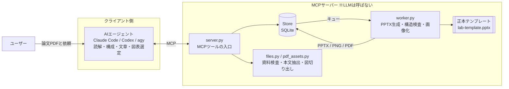
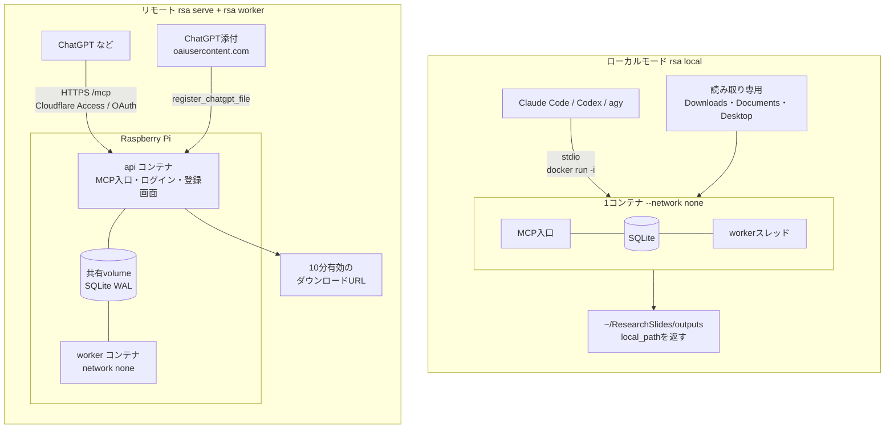
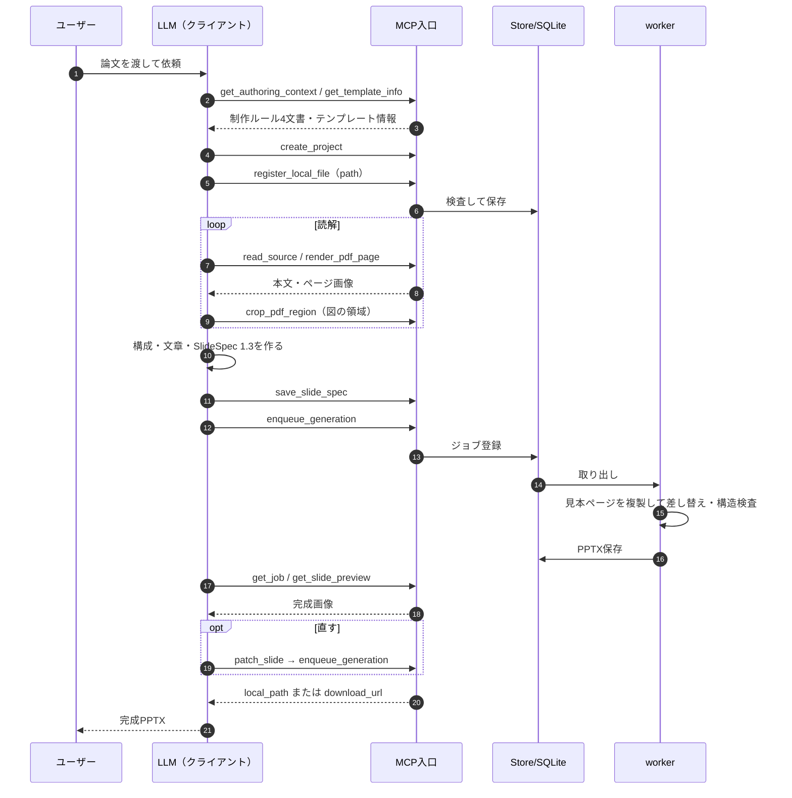
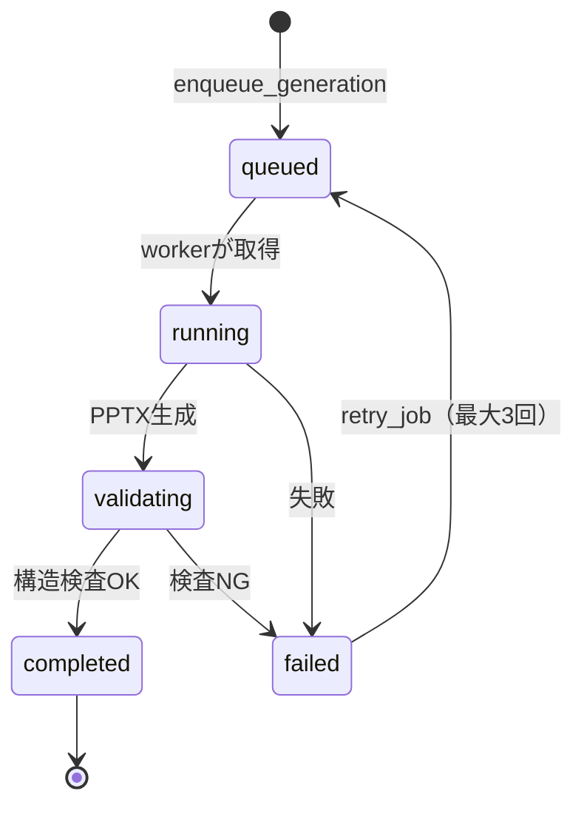

# 全体ガイド（図で理解する）

このシステムが何をして、どこで何が動くかを図で示します。細かい仕様は末尾の表から各文書へ進んでください。

**要点**: 論文を読み、構成と文章を作るのは接続した AI エージェント（LLM）です。サーバーは LLM を呼ばず、資料の保存と検査、PPTX の生成と検査だけを行います。

## 1. 誰が何をするか

## 2. local と remote の違い

| | local | remote |
|---|---|---|
| 接続 | stdio（クライアントがコンテナを起動） | HTTPS |
| 認証 | なし（所有者は固定の `local-user`） | Cloudflare Access または OAuth |
| 資料の入口 | `register_local_file`（許可フォルダのパス） | 添付の取得、またはブラウザからの登録 |
| 成果物 | 出力フォルダへ複製し `local_path` を返す | 期限付きダウンロード URL |
| 公開しないツール | `create_upload`、`register_chatgpt_file`、`show_viewer` | なし |
| 共通 | SQLite、生成エンジン、正本テンプレート、制作ルール | 同左 |

## 3. 一回の生成の流れ

## 4. ジョブの状態

## 5. MCPツールの役割

| 段階 | ツール |
|---|---|
| ルール取得 | `get_authoring_context`、`get_template_info`、`get_profile` |
| 作業枠 | `create_project`、`get_project`（7日間保持） |
| 資料登録 | `register_local_file`（local）、`register_chatgpt_file`・`create_upload`（remote）、`set_source_metadata` |
| 資料を読む | `read_source`、`render_pdf_page`、`crop_pdf_region` |
| 仕様 | `save_slide_spec`、`patch_slide` |
| 生成 | `enqueue_generation`、`get_job`、`retry_job` |
| 確認 | `get_slide_preview`、`get_preview`、`get_generation_report`、`show_viewer`（remote のみ） |
| 手編集 PPTX | `inspect_uploaded_pptx`、`propose_pptx_patch` |

引数と返り値は [API.md](../API.md)。

## 6. 処理を担う場所

| 処理 | 主体 | モジュール |
|---|---|---|
| 論文の読解、構成、文章、図表の選定 | **LLM（クライアント）** | — |
| 仕様の検査、版管理、7日の期限、所有権 | MCP プロセス | `store.py`、`models.py` |
| 資料の検査と本文抽出 | MCP プロセス | `files.py` |
| ページの画像化、図の切り出し | MCP プロセス（Poppler） | `pdf_assets.py` |
| PPTX 生成、構造検査、完成画像（LibreOffice） | **worker** | `worker.py`、`prototypes.py`、`engine.py` |
| ジョブのキュー、再試行、期限切れの削除 | worker | `store.py` |

## 7. 注意

- 品質は、接続した LLM の長文読解、画像入力、JSON 作成の能力に依存します。サーバーはスライド内容を補いません。
- 検査は構造と体裁の検査です。内容の正しさや PowerPoint 実機での見え方は保証しません（[TESTING.md](../TESTING.md)）。

## 次に読む文書

| 知りたいこと | 文書 |
|---|---|
| 使い始める | [README](../README.md) |
| 他クライアントの登録、開発 | [LOCAL.md](LOCAL.md) |
| 公開サーバーの構築 | [REMOTE.md](REMOTE.md) |
| できること・制約 | [CAPABILITIES.md](CAPABILITIES.md) |
| ツールの引数・返り値 | [API.md](../API.md) |
| 構成の詳細 | [ARCHITECTURE.md](../ARCHITECTURE.md) |
| セキュリティ | [SECURITY.md](../SECURITY.md) |
| 試験と未検証事項 | [TESTING.md](../TESTING.md) |
| 全文書の案内 | [docs/README.md](README.md) |
