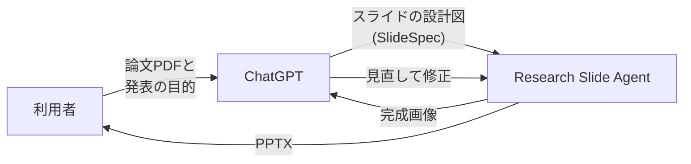
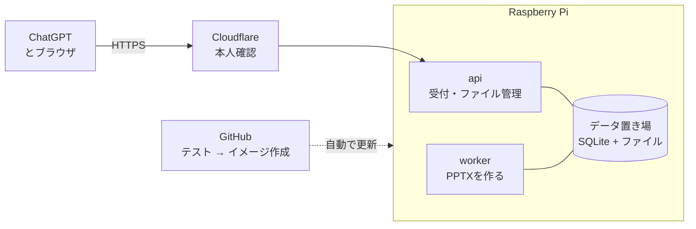

# はじめての人向け：Research Slide Agentの全体像

このプロジェクトに初めて触れる人向けに、全体を短くまとめた入門資料です。
数値・制約・詳しい仕組みの正本はリンク先の文書です。この資料と食い違う場合は、リンク先を優先してください。

## ひとことで言うと

**ChatGPTに論文を渡すと、研究室のテンプレートどおりのPowerPoint発表資料ができる仕組み**です。

- 内容（構成・文章・図の選び方）を考えるのは **ChatGPT** です。
- このサーバーは、その内容を **研究室テンプレートに沿ったPPTXに組み立てて検査** します。
- サーバー自体はLLMを呼びません。

## 使われ方

1. 利用者が、論文と「誰に・何分で発表するか」をChatGPTに伝えます。
2. ChatGPTが論文を読み、スライドの設計図（SlideSpec）を作ってサーバーに保存します。
3. サーバーがテンプレートからPPTXを作り、壊れていないかを検査します。
4. ChatGPTが完成画像を見て、読みにくい箇所があれば直して作り直します。
5. 利用者がPPTXをダウンロードし、PowerPointで最終確認します。

ほかに次の使い方があります。

- **作り直し**：保存済みの設計図を直して再生成する。
- **手直しの反映**：PowerPointで編集したPPTXの文章だけを差し替える。

## どこで動いているか

| 部品 | 役割 |
|---|---|
| Cloudflare | 外から安全につなぐ入口。許可した本人だけが使える |
| api | ChatGPTからの依頼を受け付け、資料・設計図を保存し、ダウンロードを渡す |
| worker | 依頼の順番待ちを処理し、PPTXと確認用画像を作る。インターネットにはつながらない |
| データ置き場 | 依頼の状態と資料を保存する。プロジェクトは一定期間で自動削除 |
| GitHub | mainに入るとテストしてイメージを作り、Piが自動で新しい版に入れ替える |

### 自分のPCだけで使う場合

`rsa local` で起動すると、サーバーを公開せずに自分のPCのMCPクライアント（Claude Desktop、Claude Code、Codex CLI、Gemini CLIなど）から使えます。
Cloudflareやログインは不要で、論文は決めたフォルダから読み、完成PPTXも決めたフォルダへ保存されます。手順は[README](../README.md)。

## 覚えておくと迷わない言葉

| 言葉 | 意味 |
|---|---|
| 正本テンプレート | 研究室の見本スライド。ページを複製して中身だけ差し替えるので、色や字形は崩れない |
| SlideSpec | ChatGPTが書くスライドの設計図（JSON） |
| MCP | ChatGPTがこのサーバーの機能を呼ぶための接続方式 |
| ジョブ | 「このPPTXを作って」という1件の依頼。順番待ち→作成→検査→完了と進む |
| completed | PPTXの作成と構造検査に成功した状態。見た目の確認まで済んだという意味ではない |

## 次に読むもの

| 知りたいこと | 文書 |
|---|---|
| 何ができて何ができないか | [機能と制約](CAPABILITIES.md) |
| 使い方の流れを詳しく | [利用シーン](USER_USE_CASES.md) |
| 内部の仕組み | [Architecture](../ARCHITECTURE.md) |
| 動かし方・導入 | [README](../README.md)、[Portainer手順](../deploy/PORTAINER.md)、[認証手順](../deploy/AUTH.md) |
| ツールの一覧と入出力 | [API](../API.md) |
| 文書全体の案内 | [ドキュメント案内](README.md) |
