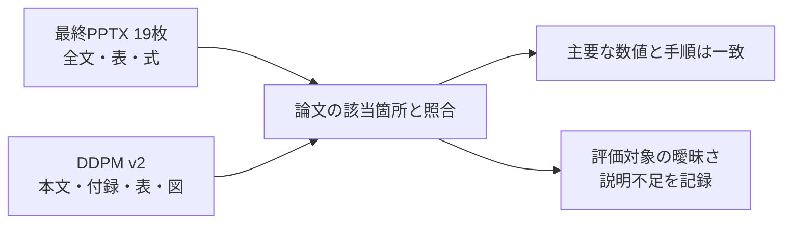

# DDPMの生成スライドは論文に忠実か

2026-11-20、統合版の最終19枚を原論文と照合しました。結論は、主要数値・学習と生成の手順・図の説明に明白な事実誤認は見つからず、評価対象の書き方に1件、説明の明確さに3件の改善点がある、です。全ての主張が正しいと保証する判定ではありません。

## 何と照合したか

- 原論文：Ho, Jain, Abbeel, *Denoising Diffusion Probabilistic Models*、arXiv:2006.11239v2。ローカルの`~/Downloads/rsa-eval/ddpm.pdf`、全25ページ。下の論文ページ番号はPDFの1始まり。
- 統合版：project `ce07b43463b548839c6ab458bd8d837b`、job `ebadb465af4d455f874d839c2c7b4e66`、19枚。PPTXのSHA-256は`74a2a6e3ca52487894f266d03ad9d9d6ef6cc3a3dba32ed92ea413e7c36e0626`。
- PPTXから可視テキスト・表・式を全ページ抽出し、論文本文・付録の該当箇所へ戻って確認。論文4・5・7・13ページは画像でも式・表・図を確認。完成画像の全ページ一覧も確認済み。
- 図の切り出し元はDBの`files.origin`で照合。同じPDFからの切り出しで、顔画像はFig.1左、段階的生成はFig.6、圧縮グラフはFig.5右、寝室画像はFig.4に対応。
- 比較前の17枚も全文・数表・主要説明を確認しました。以下は利用者が試す統合版を中心に記録しています。

## どの主張を確認したか

| スライド | 照合した内容 | 論文の根拠と判定 |
|---|---|---|
| 1 | 著者・所属・論文名・NeurIPS 2020 | p.1と一致 |
| 2 | ノイズ予測による生成、無条件CIFAR10のFID 3.17、段階的復号という解釈 | Abstract、§§3.2・4.1・4.3と整合 |
| 3 | 生成モデルの課題、GANの到達点、拡散モデルの高画質化が課題 | §§1–2、pp.1–2の整理として整合 |
| 4 | 2015年の拡散、2019年のスコア推定、DDPMでの接続・生成器の直接学習 | §5・Appendix Cと整合。先行研究の原著は未確認とスライド自身が明示 |
| 5 | ノイズ予測、スコア推定との接続、損失の重み変更を新規性として説明 | §§1・3.2・3.4と整合 |
| 6 | 画素を−1〜1へ変換、順過程は固定、1000段、任意時刻を直接生成 | §3.3、§4、Eqs.(2),(4)と一致 |
| 7 | tを1〜1000から一様抽出、既知のノイズをU-Netで予測、二乗誤差で学習 | Algorithm 1、Eq.(14)、Appendix Bと一致 |
| 8 | 標準正規ノイズから開始、1000から1へ反復、途中はノイズ追加、最後は追加しない | Algorithm 2と一致。生成時に元画像を使うという誤説明はない |
| 9 | スコアは対数密度の勾配、ノイズ予測との符号・尺度の対応、LとLsimpleの関係 | §§3.2・3.4、Eqs.(11),(12),(14)と整合。重み変更の意味の説明は不足 |
| 10 | 1000段、β=0.0001〜0.02、35.7Mパラメータ、batch 128、800k更新、各最終実験は学習1回・最小FID時点を報告 | §4・Appendix B、pp.14–15と一致。5万枚のスコア計算の対象は明確化が必要 |
| 11 | FID 3.17は訓練集合基準、テスト集合基準なら5.24、NLLは符号長 | §4.1・Table 1と一致。指標の一般的な説明はあるが、FID・IS原著の定義までは再検証していない |
| 12 | NCSN 25.32／8.87±0.12、StyleGAN2+ADA v1 3.26／9.74±0.05、DDPMのL 13.51／7.67±0.13、Lsimple 3.17／9.46±0.11（FID／IS）、NLL上界3.75 | Table 1と一致。全行が無条件の区分。数値・予測方式の取り違えはない |
| 13 | 固定分散で平均予測＋LのFID 13.22、ノイズ予測＋Lの13.51、ノイズ予測＋Lsimpleの3.17。平均の単純二乗誤差は不安定 | Table 2・§4.2と一致。「ノイズ予測に変えるだけで改善」とは述べていない |
| 14 | 粗い構造から細部へ。画像は途中のxtではなく最終画像の推定 | §4.3・Fig.6と一致 |
| 15 | NLL上界3.75の内訳1.78＋1.97、低い伝送量で誤差が急減、実用圧縮器ではない | §4.3・Fig.5・p.13の注意と整合。符号長の歪み項とRMSEの単位は区別を補うべき |
| 16 | CIFAR10を256枚生成して17秒、256×256は128枚で300秒、TPU v3-8。画像偽造・偏りの影響、他モダリティは今後 | Appendix B・Broader Impact・§6と一致。秒数を1枚の遅延へ取り違えていない |
| 17 | 目的・ノイズ予測・1000段・FID 3.17・今後の課題のまとめ | 本編と整合。新しい成果をまとめで追加していない |
| 18 | Bedroom通常6.36／大型4.90、ProgressiveGAN 8.34、StyleGAN 2.65、Church 7.89、Cat 19.75 | Table 3と一致。大型と通常、データセットの違いを明記し、GAN全てに勝つとは述べていない |
| 19 | 順過程、Lsimple、逆過程の更新式、固定分散、t=1でz=0 | Eqs.(4),(11),(14)・§3.2・Algorithm 2と一致。a(t)はα、A(t)はαの累積積として定義済み |

## どこを直すと誤解が減るか

| 箇所 | 問題 | 論文に沿った直し方 |
|---|---|---|
| 10枚目 | LSUN・CelebA-HQも並べた後で「生成5万枚でスコアを計算する」とある。CelebA-HQにも定量スコアの条件がかかるように読める | 「CIFAR10のIS・FIDとLSUNのFIDは、生成5万枚で計算。CelebA-HQは生成例を提示」と対象を限定する。Appendix B p.15で5万枚と記載するのはCIFAR10とLSUN |
| 12枚目 | 「下ほど良い」は行の位置とも読める。ISは大きい方が良いので、表全体の説明としても曖昧 | 「FIDは値が小さいほど良い、ISは大きいほど良い」とする。表が原Table 1の抜粋であることも明記する |
| 9枚目 | 「Lsimpleは時刻別の重みを除く」は正しいが、何が変わり、なぜ画質に効いたかまでは説明していない | §3.4の範囲で「この設定では小さいtの損失を相対的に弱め、より大きなノイズの除去を重視する」と補う。画質改善はTable 2の実験結果として区別する |
| 15枚目 | 「歪みの項1.97」と、図の縦軸RMSEが近くにあるが単位の違いが明示されていない | 1.97はbits/dimのL0項、RMSEは別の量と記す。§4.3では対応するRMSEを約0.95（画素0〜255尺度）と記載。1.97をRMSEとは扱わない |

この照合ではPPTX・設計書を修正していません。上記は測定に使った最終版へ残る指摘であり、修正済みという意味ではありません。

## 何が省かれているか

Table 1・2の全比較行、分散を学習した場合の詳細、損失の導出、補間実験（§4.4）、自己回帰復号との対応の導出は省略されています。短縮した紹介として直ちに事実誤認にはなりませんが、原論文全体を説明した資料ではありません。無条件CIFAR10や固定分散など、載せた比較の条件は保持されています。

DDPM自体の学習・追試、先行研究の原著確認、FID・IS実装や信頼性の独立検証、PowerPoint実機確認、15分の通し練習は行っていません。この監査は、スライドの記述が提供されたDDPM論文と整合するかを確かめたものです。
