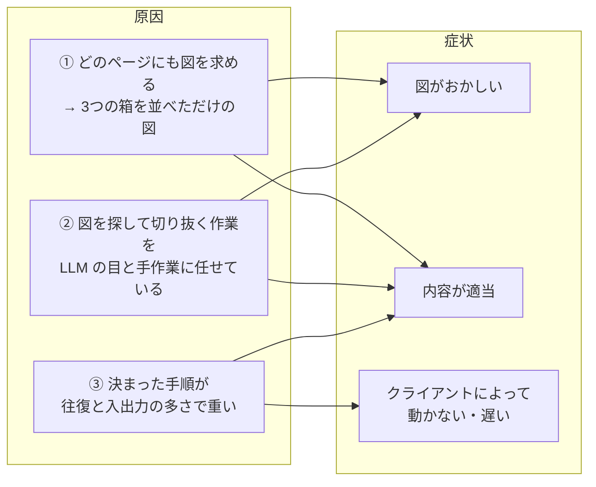
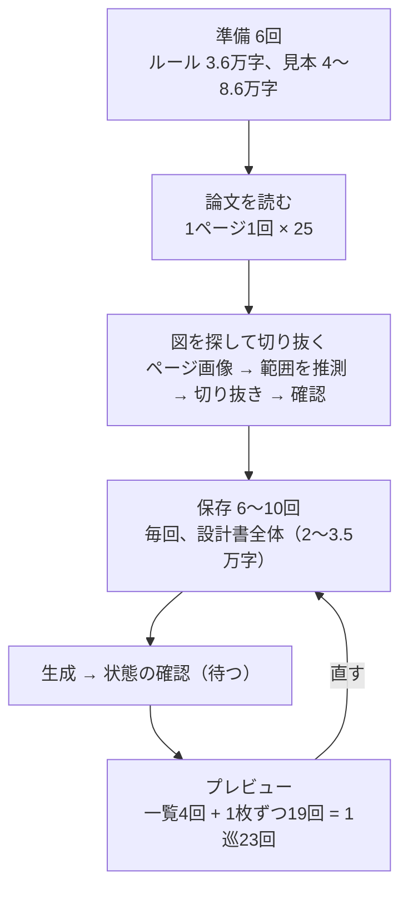
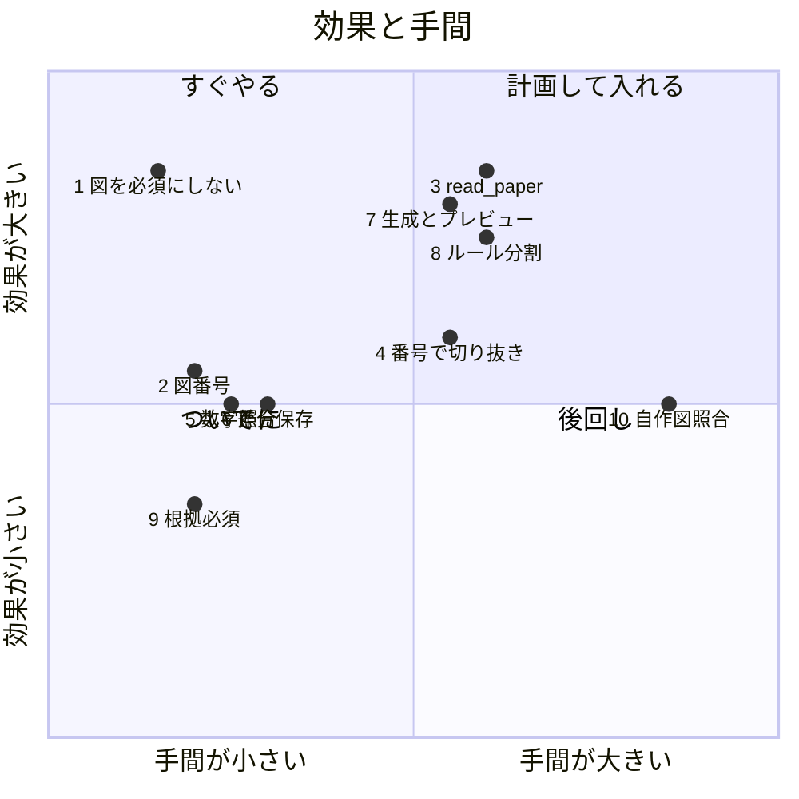

# 改善方針：往復を減らし、図と内容を論文に近づける

2026-11-22 の調査です。コードは変えていません（新しく加えたのは採点用の `scripts/eval_fidelity.py` だけです）。
ここに書く数字は、手元に残っていた生成物・DB・Codex のログから数えたものです。学生が実際に作った資料は手元にないため、その再現はまだ確かめていません（[未確認](#未確認とオーナーに決めてほしいこと)）。



## 1. 調べたもの

| 資料 | 論文 | 作り方 | 枚数 |
|---|---|---|---|
| DDPM 変更前 | Ho ら 2020（25ページ） | Codex、`86270b3` | 17 |
| DDPM 統合版 | 同上 | Codex、`79037b7` | 19 |
| 建設機械 | Ishizawa ら 2026（6ページ） | `86270b3` | 本編21＋補足2 |
| Attention | Vaswani ら 2017（15ページ） | 不明（11/17） | 19 |
| 公平性テスト | Li ら 2026 | 不明（11/17） | 28 |

保存場所は `~/ResearchSlides/outputs/` と `~/ResearchSlides/eval/` です。依頼文にあった「DDPM の本編21枚＋補足2枚」は、DB を見ると建設機械の資料でした（project `a3875ec3…`）。

## 2. 往復と入出力の量

### 1回の生成で何が何回動くか

DDPM の比較で使った Codex ワーカー2人分のログ（`~/.codex/sessions/2026/11/20/`）から数えました。Codex はツールをコードの中でまとめて呼ぶため、呼んだ回数はクライアントによって変わります。

| ツール | 変更前 | 統合版 | 1回の返事・入力の大きさ |
|---|---:|---:|---|
| ツール定義（毎ターン送られる） | — | — | 24,360字（約6千トークン） |
| `get_authoring_context` | 1 | 2 | **35,959字（約2.7万トークン）** |
| `get_template_info` | 1 | 1 | main 85,666字（約2.3万）／統合版 41,453字（約1.2万） |
| `read_source` | 全25ページ | 全25ページ | 1ページ 50〜6,300字、25ページ合計 56,131字 |
| `render_pdf_page` + `crop_pdf_region` | 3以上 | 5以上 | 画像1枚ずつ |
| `save_slide_spec` | 10 | 8 | **毎回、設計書全体 21,000〜26,000字を LLM が書き直して送る** |
| `patch_slide` | 0 | 0 | — |
| 生成ジョブ（`enqueue_generation`） | 8（失敗4） | 3（失敗0） | — |
| ツールが返した画像 | 72枚 | 60枚 | プレビュー1枚 1600×1200、一覧は6枚ずつ |
| 最後の時点の文脈 | 268,593 | 245,236 | トークン |
| 入力トークンの累計 | 795万 | 761万 | 97% はキャッシュ |

大きさは `scripts/measure_llm_payload.py` で測りました（トークンは推定）。前回の報告にあった main の 57,552字は、今回の方法では 85,666字になりました。測り方が違うためで、どちらにしても大きいことは同じです。

### 往復を増やしている所



- **ルールが1つの返事に収まりきらない。** `get_authoring_context` は推定 2.7万トークンです。Claude Code が MCP の返事を切る既定の上限（約2.5万トークン、`MAX_MCP_OUTPUT_TOKENS`）を超える恐れがあります。Codex でも、元43,939トークンの出力が途中で切られた記録があります。
- **論文は25往復で読む。** 本文は全部で 56,131字しかなく、ルール（35,959字）と同じくらいの量です。それでもページごとに1回ずつ呼ぶ必要があります。Codex は25回分をまとめて呼びましたが、それができない Claude Code や Gemini CLI では、本当に25往復かかります。また、ルールにもツールの説明にも「全ページを読め」とは書かれていません。そのため、弱いモデルや急いだ生成では、一部のページだけを読んで作る心配があります。
- **小さな直しでも全体を送る。** `patch_slide` は2回とも使われず、8〜10回の保存のたびに設計書全体を書き直していました。これは LLM の出力トークン（遅く、高い）を使います。
- **プレビューは1枚ずつ。** 19枚なら1巡で23回呼び、Codex は3巡しました。コードでまとめて呼べないクライアントで数えると、1回の生成で合わせて **約120〜140往復** と見込まれます（準備6、読む25、図5〜10、保存8、生成と確認10前後、プレビュー23×3）。

## 3. 「図がおかしい」「内容が適当」の具体例

### 図

| # | 資料・ページ | 起きていること | 分類 |
|---|---|---|---|
| F1 | DDPM 統合版 2〜11、16、19枚目 | **19枚中11枚が「A → B → C」の3つの箱だけの図**。例：3枚目「学習画像 → 分布を学習 → 新しい画像」。本文以上の情報がない | 検査の不足（図をどのページにも求める） |
| F2 | 建設機械 6枚目「記録から実行まで」 | 論文の **Fig. 1（システム全体図）を使わず**、「記録 → 生成 → 実行」の3箱で置き換えた。中継プログラム、ROS 2、HTTP、実行ログの戻りが抜けている。DB の引用には `Fig.1` と書いてあるのに、図は載っていない | 図の選択の失敗 |
| F3 | Attention 9枚目「注意の3つの使い方」 | LLM が自分で描いた図で、符号器と復号器の両方から「K Q V」がまとめて符号器-復号器注意へ入っている。論文 §3.2.3 では、Q は復号器、K・V は符号器の出力から来る。**関係を取り違えている** | LLM が描いた図の誤り |
| F4 | 建設機械 2・7・21枚目 | 同じ建機の写真（Fig. 2）を3回使っている。7枚目「4部位の目標角度を記録」は記録の仕組みの話なのに、図は建機の外観 | 図と説明の対応ずれ |
| F5 | 建設機械 11枚目 | Fig. 7(b) を途中で切り抜いたため、上下にブロックの切れ端が残っている。切り抜いた範囲はページの1.8% | 切り抜きの失敗 |
| F6 | 建設機械 7枚すべて、DDPM 統合版 5枚すべて、変更前 7枚すべて | 図題が「TB20e」「単関節例」「CelebA-HQ」など。**図番号がなく**、論文のどの図かが分からない（DB の引用には `Fig.7(a)` などがある） | 根拠を示さない |
| F7 | Attention 2・6・19枚目、DDPM 2・17枚目 | 同じ図の使い回し（まとめで再掲するのはルールで許されている） | 参考 |

図が増えた直接の原因は2つあります。

1. 教授ルール G11「各スライドに写真や図形を少なくとも一つ配置」（`professor-guidelines.md`）
2. サーバーが表紙以外で図のないページに `MISSING_EXPLANATORY_VISUAL` を返す（`prototypes.py` の `authoring_feedback()`）

LLM はこの指摘を消そうとして、作るのがいちばん簡単な3つの箱の図を足します。図の枠が小さく、ノードを最大6段・1段4つまでに制限していることも、3つの箱を選ぶ理由になっています。

### 内容

全5資料にある数字を、論文の本文と機械で照合しました（`scripts/eval_fidelity.py`）。

| 資料 | 数字 | 本文に同じ表記がない | 確かめた結果 |
|---|---:|---:|---|
| DDPM 変更前 | 55 | 2 | `0.0001`（論文は 10⁻⁴）、`256²` の表記。**誤りなし** |
| DDPM 統合版 | 66 | 1 | `0.0001`。**誤りなし** |
| 建設機械 | 43 | 8 | すべて Fig. 7 の画像から読んだ値で、画像と一致。**誤りなし** |
| Attention | 52 | 1 | 「約450万文対」（論文は 4.5 million）。**誤りなし** |
| 公平性テスト | 132 | 4 | Table 3 の合計（6,782＋46,260＋54,538＝107,580、本文の合計と一致）と、100−80.7＝19.3。**誤りなし** |

Codex による DDPM 19枚の照合（元のワークスペースの `docs/ddpm-content-review.md`）でも、事実の誤りは0件で、あいまいな書き方が4件でした。

つまり、手元の資料では **数字の誤りは見つかりませんでした**。「内容が適当」と感じさせているのは、次の点だと考えます。

| # | 例 | 分類 |
|---|---|---|
| C1 | 建設機械 10・11枚目は、図に書いてある値（`1.167秒`、`0.986`、`41.62度` …）を本文で読み上げているだけ。なぜその値になるのか（区間の分け方、速度の計算）は補足の22枚目にしかない | 説明の深さ不足 |
| C2 | F1 の3つの箱の図が11枚あり、どのページも同じ形に見える。読む人には「中身のない資料」と映る | 図の検査の不足 |
| C3 | F6 のとおり、図の出典が論文のどこかを確かめられない。DDPM 変更前は、ページ番号を書いた根拠が17枚中7枚しかない | 根拠を示さない |
| C4 | F3 のように、自作図だけが論文と食い違う。文章は合っていても、図が誤解を生む | LLM が描いた図の誤り |
| C5 | （手元の資料では起きていない）論文を一部のページしか読まずに作る心配がある。ルールにも説明にも「全ページを読め」がない | 全文が届いていない恐れ |

手元の資料は、どれも Codex など強いモデルで、時間をかけて作ったものです。学生が使ったクライアント・モデルでは C5 が実際に起きている可能性がありますが、その資料はまだ見ていません。

## 4. 直し方と優先順位

効果・手間・リスクは「大・中・小」で示します。

| 順 | 直し方 | 直す原因 | 効果 | 手間 | リスク |
|---|---|---|---|---|---|
| **1** | **図を必須にしない。** `MISSING_EXPLANATORY_VISUAL` をやめ、代わりに「3つ以下の箱を一直線に並べただけの図」に `TRIVIAL_DIAGRAM` を返す。ルールに「図は本文にない情報を足すときだけ。手法の全体像は原図を優先」と書く | F1、F2、C2 | 大 | 小（`prototypes.py` とルール文） | G11 と食い違う → オーナーの判断が必要 |
| **2** | **図題に図番号を必ず入れる。** 引用の locator に `Fig./Table` があれば、サーバーが図題の頭に「Fig. 7(b)」を付ける。なければ保存時に指摘する | F6、C3 | 中 | 小 | 小 |
| **3** | **サーバーで論文の構造を取り出す。** 新しいツール `read_paper` が、本文（約2万トークンずつ、1〜3回）、節の見出し、図・表の一覧（番号、ページ、図題、範囲）を返す。範囲は、イメージに入っている Poppler の `pdftotext -bbox-layout` で、図題の行と段組から推定する | C5、F2、往復 | 大 | 中 | 図の範囲推定の失敗 → `crop_pdf_region` を残しておく |
| **4** | **図は番号で選ぶ。** `crop_pdf_region(figure="Fig. 1")` のように番号を指定すると、サーバーが図を丸ごと切り抜く。トリミングはしない。部分だけ使うときは `region` も指定する | F5、F2、往復 | 中 | 中（3 が前提） | 小 |
| **5** | **保存時に数字を照合する。** 設計書の数字のうち、論文の本文にないものを `authoring_feedback.unverified_numbers` で返す（`eval_fidelity.py` と同じ処理）。換算や合計の数字は、根拠の書き込みを求める | 安全網（弱いモデル向け） | 中 | 小 | 誤検出 → 指摘にとどめ、保存は止めない |
| **6** | **小さな直しは差分で送る。** `patch_slide` を複数ページの差分を受けられる形に広げ、ルールにも「2回目からは差分」と書く | 保存のたびに全体を送る | 中 | 小 | 小 |
| **7** | **生成とプレビューを1回にまとめる。** `enqueue_generation(wait=True)` で完成まで待ち、全ページの一覧画像（6枚ずつ、2〜4枚）と、機械で見つけた問題があるページの番号を一緒に返す | 1巡23往復 | 大 | 中 | 待つ時間がクライアントの時間切れを超える恐れ → 上限を決める |
| **8** | **ルールを分けて渡す。** 必ず読む核（1万字以内）と、必要なときに読む細則に分ける。`get_template_info` は、使う見本だけを返す引数を持たせる | 上限超え、往復 | 大 | 中 | 規則の抜け → 評価で確かめる |
| 9 | ページごとの根拠を必須にする。各ページの `source_references` にページ番号（`p.`）を求める | C3 | 小〜中 | 小 | 小 |
| 10 | 自作図を論文と照合する。図のノードとつながりを、論文の該当節と LLM 判定で比べる | F3 | 中 | 大 | 判定の誤り |



### まずやる3手

1. **1と2を一緒に入れる**（数日）。3つの箱の図がなくなり、図題で論文の図をたどれるようになります。下の評価で、`trivial_chain_diagrams` と「図番号のない図題」の数が減ったかを見ます。
2. **3と4を入れる**（1〜2週間）。全文を1〜3往復で渡し、図の一覧を返し、図を番号で切り抜けるようにします。Fig. 1 の使い忘れや、図の途中での切り抜きを減らし、読む往復も25回から3回ほどに減らします。
3. **6と7と8を入れる**（1〜2週間）。1回の生成の往復を、見込みの約130回から40回以下にすることを目標にします。ルールを Claude Code の上限内に収めます。

## 5. 改善を測る方法

同じ論文・同じ依頼で、次の表を毎回埋めます。手で数えるのは、最後の2行だけです。

| 区分 | 何を | どう測るか | 今の値（下の表） |
|---|---|---|---|
| 体裁 | 生成の失敗回数、保存の回数、最後の `fit_problems` の数 | DB の `jobs`・`specs` | 済み |
| 体裁 | 重なり・欠け・読めない図のページ数 | 完成画像を目で見る（1ページ 0/1） | 未 |
| 図 | 3つ以下の箱の図、図番号のない図題、同じ図の使い回し、引用に Fig. があるのに図がないページ | `scripts/eval_fidelity.py`（DB を読む） | 済み |
| 内容 | 数字のうち論文の本文にないもの → 手で確かめた誤りの数 | `scripts/eval_fidelity.py`、そのあと手で確認 | 済み（誤り0） |
| 内容 | 根拠にページ番号があるページの割合 | `scripts/eval_fidelity.py` | 済み |
| 内容 | 必ず入れる事項（1論文10項目）が入っているか | 論文ごとに一度だけ一覧を作り、手で照合 | 未 |
| 内容 | 主張10個を抜き出し、論文と照合したときの誤り・あいまいさの数 | 手、または LLM 判定（Codex の DDPM 照合と同じ方法） | DDPM 統合版のみ（誤り0、あいまい4） |
| 往復 | MCP 呼び出しの回数、返事の合計字数、画像の枚数、最後の文脈トークン | クライアントのログ（Codex は `~/.codex/sessions`） | Codex 2回分のみ |

使う論文は DDPM・建設機械・Attention の3本、クライアントは Claude Code（Sonnet）と Codex、各2回です。クライアント側の出力上限は、条件をそろえるために記録しておきます。

```sh
python scripts/eval_fidelity.py --pptx <出力>/presentation.pptx --pdf <論文>.pdf \
  --db <データ>/state.sqlite3 --project <project id>
```

### 今の値（ベースライン、2026-11-22）

| 資料 | 枚数 | 数字（本文にない／誤り） | 3つ以下の箱の図 | 描いた図 | 図題に番号なし／図の数 | 引用に Fig. があるのに図なし | ページ番号つきの根拠 |
|---|---:|---|---:|---:|---|---|---:|
| DDPM 変更前 | 17 | 55（2／0） | 5 | 6 | 7／7 | 0 | 7／17 |
| DDPM 統合版 | 19 | 66（1／0） | **11** | 11 | 5／5 | 0 | 19／19 |
| 建設機械 | 23 | 43（8／0） | **10** | 11 | 7／7 | 6・8・9・22枚目 | 23／23 |
| Attention | 19 | 52（1／0） | 2 | 4 | 0／6 | 0 | 18／19 |
| 公平性テスト | 28 | 132（4／0） | **10** | 11 | 0／2 | 20枚目 | 26／28 |

3つ以下の箱の図は、DDPM 統合版・建設機械・公平性テストで全体の36〜58%を占めます。直し方1の効果は、この列でそのまま測れます。

## 未確認とオーナーに決めてほしいこと

未確認のこと：

- 学生が作った資料と、その時のクライアント・モデル。手元の5資料では数字の誤りが0件で、学生の声の「内容が適当」をそのまま再現できていません。
- Sonnet 5.5 での比較。前回のテストのログは残っておらず、今回は採点していません。
- Claude Code が `get_authoring_context` を実際に切るかどうか。推定トークン数で上限を超える見込みと書いただけで、実際に確かめてはいません。

決めてほしいこと：

1. **教授ルール G11「各スライドに図を1つ以上」を緩めてよいか。** 直し方1はこれと食い違います。「表・式・原図があれば図とみなす」「図がないページを認める」のどちらにするかを決めてください。
2. **学生の資料を集めるか。** 使ったクライアント（ChatGPT、Claude Desktop など）と、具体的に「どのページのどこが」おかしかったかが分かれば、C5（全文が届いていない）を確かめられます。
3. **ツールの形を変えてよいか。** `read_paper` を足すこと、`crop_pdf_region` や `enqueue_generation` に引数を足すことは、今のプラグインと ChatGPT（remote）の両方に影響します。古いツールをどのくらい残すかを決めてください。
4. **評価に使う論文と「必ず入れる事項」の一覧を、誰が作るか。** 論文1本につき10項目ほどです。
