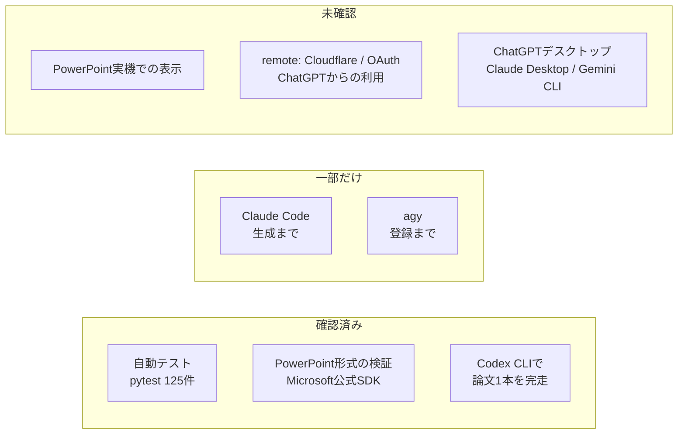

# 検証状況

「動く」と言える範囲です。新しく確かめたら、日付と方法を書き足してください。

## 自動テスト（CI で毎回実行、`.github/workflows/ci.yml`）

| 何を | どう |
|---|---|
| コード全体 | `ruff` と `pytest`（`tests/`） |
| 同梱の正本 | `scripts/template_smoke.py` |
| 生成した PPTX の形式 | Microsoft の Open XML SDK で検証（`tools/pptx-validator/`） |
| イメージ | ARM64 / AMD64 をビルドして GHCR に公開 |

テストが確かめていることの主なもの：

- 見本ページの複製、書式の保持、はみ出したときの拒否、40枚の生成、元ファイルを壊さないこと
- 表（1〜3列）の書式。色・罫線・文字サイズなどを変えた出力を検査が拒否すること
- 持ち主・期限・版番号の競合・ジョブ管理・入力検査・ブラウザ認証と CSRF
- 実際の HTTP 経由の MCP で、完成後に PPTX を取得できること
- local：許可フォルダ外・シンボリックリンク・`..`・相対パスの拒否。`rsa local` を実際に起動して完成まで進むこと

## 実際の AI エージェントでの確認

| 日付 | 内容 | 結果 |
|---|---|---|
| 2026-11-10 | Codex CLI、Docker の local、論文 He et al. "Deep Residual Learning"（CVPR 2016） | 登録→図の切り抜き→保存→生成→画像確認→修正まで完走。10枚 |
| 2026-11-10 | Claude Code、同じ条件 | 生成まで。利用上限で停止 |
| 2026-11 | agy | `make register AGENT=agy` で登録できることまで |
| 2026-11 | `make doctor` / `make smoke`、`mcp-agent.sh`（偽の codex で選択・中止を確認） | 動作 |

## 未確認

- **PowerPoint 実機**での表示（完成画像は LibreOffice の近似表示です）
- **remote 一式**：Cloudflare Access の初回ログインとトークン更新、OAuth 方式、ChatGPT からの添付取り込みと表示
- ChatGPT デスクトップ（Codex / Work モード）、Claude Desktop、Gemini CLI での生成
- 別の論文・別のモデルでの品質や再現性
- `make build` / `make update` の通し実行
