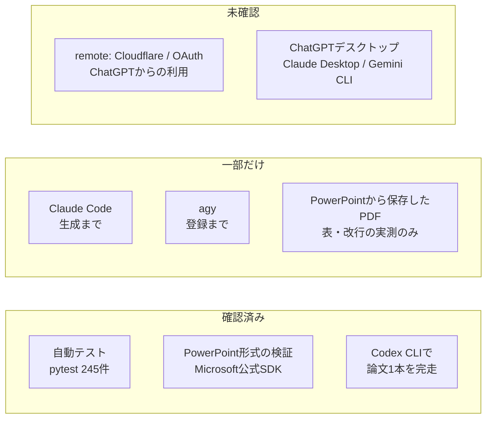

# 検証状況

「動く」と言える範囲です。新しく確かめたら、日付と方法を書き足してください。

## 自動テスト（CI で毎回実行、`.github/workflows/ci.yml`）

| 何を | どう |
|---|---|
| コード全体 | `ruff` と `pytest`（`tests/`） |
| 同梱の正本 | `scripts/template_smoke.py` |
| 生成した PPTX の形式 | Microsoft の Open XML SDK で検証（`tools/pptx-validator/`） |
| イメージ | ARM64 / AMD64 をビルドして GHCR に公開 |

テストが確かめていることの主なもの：

- 見本ページの複製、書式の保持、はみ出したときの拒否、40枚の生成、元ファイルを壊さないこと
- 表（1〜3列）の書式。色・罫線・文字サイズなどを変えた出力を検査が拒否すること
- 持ち主・期限・版番号の競合・ジョブ管理・入力検査・ブラウザ認証と CSRF
- 実際の HTTP 経由の MCP で、完成後に PPTX を取得できること
- local：許可フォルダ外・シンボリックリンク・`..`・相対パスの拒否。`rsa local` を実際に起動して完成まで進むこと

## 実際の AI エージェントでの確認

| 日付 | 内容 | 結果 |
|---|---|---|
| 2026-11-10 | Codex CLI、Docker の local、論文 He et al. "Deep Residual Learning"（CVPR 2016） | 登録→図の切り抜き→保存→生成→画像確認→修正まで完走。10枚 |
| 2026-11-10 | Claude Code、同じ条件 | 生成まで。利用上限で停止 |
| 2026-11 | agy | `make register AGENT=agy` で登録できることまで |
| 2026-11 | `make doctor` / `make smoke`、`mcp-agent.sh`（偽の codex で選択・中止を確認） | 動作 |

## 容量・はみ出し・矢印ラベル（2026-11-18）

`research-slide-agent:local` のコンテナに作業ツリーをマウントし、`RSA_ENV=development` で実行しました。

| 確認 | 結果・範囲 |
|---|---|
| `ruff check src tests` / `pytest -q` | 245件合格（2026-11-20）。Starlette依存の非推奨警告1件 |
| `tests/test_fit_capacity.py` | 英単語と禁則文字の折り返し、表の高さ超過と短縮後の生成、最小行高の保持、本文4行上限、配置ごとの容量、1ページ内の複数のはみ出し、縦横の合流ラベル、配置不能なラベルの拒否、1行より長い英単語の文字単位の折り返し、表の複数セル・図の複数の箱のはみ出しを全件返すこと |
| `tests/test_local.py` | 保存時の2ページ・計4枠の指摘が失敗ジョブの `output.problems` と一致。`get_job` / `get_preview` の `output` はオブジェクト、未完了では `null`。完成PPTXのローカル出力も確認 |
| `tests/test_state.py` | 240件の配置エラーを欠けずに保存。内部保存は従来のJSON文字列のまま |
| 同梱の作例 | `template_smoke.py`、卵の例、`preview_smoke.py`、research-quality、construction-regression の生成が成功。後者2つはLibreOfficeで画像化も成功 |
| PowerPointの形式 | .NET 8コンテナでMicrosoft Open XML SDKの検証を実行。正本・上記5出力・Transformer修正版の計7ファイルでエラー0件 |
| `scripts/container_smoke.py` | 実HTTPのMCP経由で5枚を生成し、PPTXをダウンロード。新しい `output` オブジェクトで成功 |
| Transformer論文の保存済み19枚 | 旧設計書の4枚目は表の必要高さ3.26インチ／使用可能2.95インチとして拒否。短縮済み設計書は生成・画像化が成功 |
| 修正版4・9枚目の画像を目視 | LibreOffice表示で、表と下の本文の重なり、K・VとQのラベル同士の重なりがないことを確認 |

前のセッションでユーザーがPowerPointから保存したTransformer資料と建設機械資料のPDFを使い、行高・折り返しを測りました。`prototypes.py` は本文の行高を文字サイズの1.1倍、表を1.17倍として見積もります。LibreOfficeでは表の行がより高く描かれるため、両者が一致するわけではありません。修正版PPTXのPowerPoint実機表示は未確認です。

これは保存済み設計書の再実行と回帰検査です。AIが新しく論文を読んで作る際の「再生成6回→2回以内」や「必要な事実の省略ゼロ」は未検証です。評価用資料には以前の内容面の指摘も残っており、論文説明の品質改善を示す結果ではありません。

## 未確認

- **修正版のPowerPoint実機表示**と、全ページ・各種フォントでの表示（完成画像は LibreOffice の近似表示です）
- **remote 一式**：Cloudflare Access の初回ログインとトークン更新、OAuth 方式、ChatGPT からの添付取り込みと表示
- ChatGPT デスクトップ（Codex / Work モード）、Claude Desktop、Gemini CLI での生成
- 別の論文・別のモデルでの品質や再現性
- `make build` / `make update` の通し実行

## LLM に渡す量（2026-11-20）

`scripts/measure_llm_payload.py` で、ツールを実際に呼んだときの返事の長さを測りました。トークン数は「全角1文字=1、それ以外4文字=1」の概算です。

| 返事 | 変更前 | `get_template_info` 軽量化後 |
|---|---|---|
| ツール定義（remote 23個、毎回） | 24,065字（約6.0k） | 同じ |
| `get_authoring_context` | 35,959字（約27.0k） | 同じ |
| `get_template_info` | 85,666字（約23.0k） | 24,969字（約7.3k） |
| `save_slide_spec` の返事（合成8枚） | 4,844字（約1.3k） | 同じ |

`pytest -q` は、`pdftoppm` が無い macOS で PDF 描画の11件を除き合格しました（変更前も同じ11件が失敗）。

容量の目安（`slot_capacity`）を加えた統合版では、`get_template_info` は 41,453字（約11.7k）でした（2026-11-20、コンテナ内で `pytest -q` 250件合格）。容量の表のぶん約16,500字増えています。AI が作るスライドの品質や、弱いモデルでの成功率が変わるかは、まだ測っていません。
